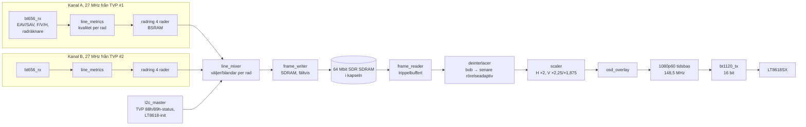

# Gateware-plan: två TVP5150AM1 → mixer → bildbuffert → 1080p60 (utkast 2026-10-01)

Mål-FPGA: Gowin GW2AR-18 (Tang Nano 20K under utveckling, sedan rev A). Underlag: pthalin/video_scaler (VHDL, GPL-3.0; `research/raw/gateware/`), TI TVP5150AM1-datablad (SLES209E), Gowin DS226, `design/REV_A_KONCEPT.md`.

## Vad vi lär av pthalin/video_scaler

- **Ingång:** använder TVP5150:s separata AVID/VBLK-stift och skriver Y/C-par i en FIFO, klockat av dekoderns 27 MHz (`fifo_writer_5150.vhd`).
- **Initiering:** bara tre I2C-skrivningar till adress BAh: `03h=AFh` (Miscellaneous controls), `0Fh=02h` (Configuration shared pins), `0Dh=40h` (Outputs and data rates select). Registernamnen stämmer med databladet; bitbetydelserna ska läsas innan vi kopierar dem.
- **Utgång:** 720p, bob + närmaste granne, en enda radbuffert (722 pixlar). HDMI-tidsbasen nudgas långsamt mot ingångens VSYNC via MMCM-fasskift (`fifo_reader.vhd`, `ps_control.vhd`) — Xilinx-specifikt, finns inte i Gowin.
- **Slutsats:** bra referens för BT.601/656-hantering och initiering, men arkitekturen (ingen bildbuffert, genlock via Xilinx-MMCM) byts ut. Vi skriver nytt, i Verilog eller VHDL (val öppet), och lånar idéer med GPL-hänsyn (se nedan).

## Arkitektur

### Moduler

| Modul | Klockdomän | Innehåll |
|---|---|---|
| `bt656_rx` | 27 MHz (per TVP) | Avkodar EAV/SAV i 8-bitars BT.656 (inbäddad synk → 9 stift per dekoder i stället för 12+). Hamming-kontroll av XY-ordet. Fält/rad-räknare. **Tål trasiga rader**: räknar faktiska sampel per rad, antar inte 720 (rrk1, ADI). |
| `line_metrics` | 27 MHz | Per rad: (1) EAV/SAV-fel, (2) radlängd i klockor vs nominellt (1716 NTSC / 1728 PAL), (3) **högfrekvensenergi i luma** (summa |Y[n]−Y[n−1]|) — brus/"snö" vid svag signal höjer den, (4) medelluma. |
| `i2c_master` | systemklocka | Initierar båda TVP (B8h/BAh) och LT8618SX. Pollar 88h (H/V-lås, "lost lock", 50/60 Hz) och 89h (bit 6 "Weak signal") per fält → statusbitar till mixern. |
| `line_mixer` | systemklocka | Väntar tills samma (fält, rad) finns från båda kanaler (timeout om en saknas). Väljer per rad den kanal med lägst felpoäng (låsstatus, weak-signal, EAV/SAV-fel, radlängdsavvikelse, HF-energi) med **hysteres** så valet inte fladdrar. Om båda är bra och lika: medelvärde (blandning). |
| `frame_writer` / `frame_reader` | SDRAM-klocka | Fält i SDRAM; trippelbuffert så utgången alltid har en hel bild. Bandbredd: skrivning ≈ 21 MB/s (720×576×2 B×25, eller 720×480×2 B×29,97); läsning för 60 Hz ≈ 21 MB/s (bob, ett fält per utbild) till ≈ 41–50 MB/s (två fält för rörelseadaptiv). 32-bitars SDR SDRAM vid ~100 MHz ger 400 MB/s rå, men radbyten, refresh och arbitrering äter en stor del — kräver en arbiter med prioritet för läsning (rättat efter granskning, receipt 104). |
| `deinterlacer` | pixelklocka | Steg 1: bob (radinterpolering) — enkel, ingen extra fördröjning. Steg 2: rörelseadaptiv (weave där stilla, bob där rörelse) med föregående fält ur SDRAM; ADI rekommenderar fältbaserad deinterlacing framför radfördubbling (text hoppar annars). |
| `scaler` | 148,5 MHz | 720×480/576 → **1440×1080** (exakt 4:3) centrerad i 1920×1080 med svarta kanter. H: ×2 (linjär). V: ×2,25 (NTSC) / ×1,875 (PAL), bilinjär med 2 radbuffertar (≈ 0,15 ms, Reddit-tråden). |
| `osd_overlay` | 148,5 MHz | Text/staplar: vald kanal, mixläge, låsstatus per kanal, kanal/band. |
| `timing_1080p60` + `bt1120_tx` | 148,5 MHz | CEA-861 1080p60 (2200×1125). 16-bitars YCbCr 4:2:2 med inbäddad synk (BT.1120) till LT8618SX. |

### Bildfrekvens

- **NTSC (59,94 Hz) in:** utgång 1080p60 med pixelklocka 148,5 MHz → en bild upprepas ungefär var 16:e sekund (knappt märkbart). Alternativ: 1080p59,94 (148,35 MHz) och fri låsning — kräver att glasögonen accepterar 59,94 (kontrolleras).
- **PAL (50 Hz) in:** 1080p60 betyder att var femte bild visas två gånger (ryck). 1080p50 vore bättre men XR-glasögonens stöd för 50 Hz är obekräftat (XR-underlaget). → Rekommendation: kör kameran i NTSC.
- Latensbudget: ≈ 1 fält (16,7–20 ms) buffert + skalning (< 1 ms) + glasögonens egen fördröjning. Ska mätas med `tests/latency/`.

## Resursuppskattning (grov, att verifiera vid syntes)

| Resurs | GW2AR-18 har | Behov (uppskattning) |
|---|---|---|
| BSRAM | 828 kbit (46 block) | Radringar 2 × 4 × 720 × 16 bit ≈ 92 kbit; skalare 2–3 × 1440 × 16 bit ≈ 69 kbit; OSD-font/text ≈ 20 kbit; FIFO:er ≈ 50 kbit → **≈ 230 kbit** |
| Multiplikatorer | 48 (18×18) | Bilinjär skalning + blandning: < 16 |
| LUT4 | 20 736 | Okänt; SDRAM-styrning + 2 ingångar + skalare + OSD + I2C. rrk1:s enkanal utan buffert använde ~¼ av XC7A35T (~5 000 LUT6). Risk: tajt men troligt. |
| PLL | 2 i QN88 (Sipeed) | 148,5 MHz pixel + SDRAM-klocka. Två TVP-klockor kommer utifrån. |

## Granskning (DeepSeek V4 Pro via A0, receipt 104, 2026-10-01)

Kontrollerat: skalfaktorer, 1080p60-timing (2200×1125×60 = 148,5 MHz), TVP-registeradresser och 89h bit 6 "weak signal", 59,94→60 Hz-upprepning ≈ var 16,7:e s — korrekt. Skrivbandbredden var fel (rättad ovan).

Tas med som krav:
1. **SDRAM-arbiter** för skriv/läs + refresh, med bandbreddsbudget inklusive radbyten.
2. **TVP 0Dh:** standardvärdet är 47h (datablad); kontrollera vilka bitar som ger 8-bitars BT.656 *med inbäddad synk* innan `bt656_rx` antar det. pthalin använde 40h och separata synkstift.
3. **Fältidentitet** (F-biten ur EAV) måste följa med genom klockdomäner och SDRAM så deinterlacern parar rätt fält.
4. **FIFO-djup** mellan de två 27 MHz-domänerna: samma VTX gör att kanalerna inte driver isär, men låsning, fasskillnad och trasiga rader måste absorberas; dimensionera och mät.

Avvisat: att 148,5 MHz inte kan syntetiseras ur 27 MHz utan bråktals-PLL — 148,5 = 27 × 11/2, ett heltalsförhållande (IDIV/FBDIV) som Gowins PLL hanterar; Tang Nano 20K använder 27 MHz-kristallen för HDMI. VCO-gränser kontrolleras vid implementering.

## Pinbudget på Tang Nano 20K (tillagt efter Astras granskning)

Tang Nano 20K har **34 fria I/O** på stiftlisterna (Sipeed-datablad). Kortets egen HDMI-kontakt har egna FPGA-stift (räknas inte i de 34).

| Steg | Signaler | Stift | Ryms? |
|---|---|---:|---|
| M1: en TVP (avtappning i Moneagle eller modul) → kortets HDMI 720p | YOUT0–7 + SCLK (+ ev. I2C-avlyssning 2) | 9–11 | ✔ |
| M4: två TVP → kortets HDMI 720p | 2 × 9 + I2C 2 + 2 × RESETB | 22 | ✔ |
| M5 alt. A: två TVP + LT8618SX via BT.1120 16 bit | 18 + 16 data + 1 klocka + I2C 2 + reset 2 | 39 | ✘ |
| M5 alt. B: två TVP + LT8618SX via **8-bitars BT.656 DDR @ 148,5 MHz** (M5Stack-koden markerar `Input_BT656_8BIT` "OK"; om det gäller 1080p60 är inte verifierat) | 18 + 8 + 1 + 2 + 2 | 31 | ✔ men 148,5 MHz DDR över stiftlister kräver ett ordentligt adapterkort |
| M5 alt. C: **en** TVP + LT8618SX via BT.1120 | 9 + 17 + 2 + 1 | 29 | ✔ — räcker för att verifiera 1080p60 mot glasögonen |

**Beslut:** M1–M4 på Tang Nano 20K med kortets egen HDMI (720p60, inom specen) mot TV/skärm. 1080p60 till glasögonen verifieras med alt. C. Full kombination (två TVP + LT8618SX) först på eget kort (rev A).

## Hur mixern utvecklas utan att gissa

Kommersiella mixers (RapidFire, Fusion, SteadyView) är proprietära. Vår kvalitetsmetrik ovan är en **hypotes**. Därför:

1. **Spela in data först.** Två mottagare på samma kanal → två billiga USB-composite-fångare på en dator, samtidigt. Latens spelar ingen roll offline. Flyg nära, långt bort, bakom hinder.
2. **Verifiera synkroniseringen innan algoritmen bedöms** (tillagt efter Astras granskning). USB-fångare deinterlacar och skalar ofta, så *exakt* fält- och radidentitet finns inte i inspelningarna. Därför:
   - Matcha **varje bild** A↔B på innehåll inom ± några bilder (inte bara en global förskjutning), så tappade och upprepade bilder upptäcks och tas bort. Rapportera andel matchade bilder och kvarvarande skillnad på rena rader; en inspelning där matchningen är osäker används inte.
   - Lägg en **synlig markör** i kamerabilden (t.ex. latensriggens slumpblinkande LED) så tidsjusteringen kan kontrolleras oberoende av scenen.
   - Bildförskjutning verifieras på rena rader i båda kanalerna (residual efter justering ≈ brusnivån).
   - Jämför alltid **mix mot A ensam och B ensam** på samma bilder: andel "snöiga" rader (HF-energi > k × median), medelbrus, samt visuell granskning. Utan facit är målet att mixen är minst lika bra som den bästa kanalen i varje bild och bättre i snitt.
   - **Radexakt** jämförelse kräver okomprimerad BT.656 från två dekodrar i samma FPGA (M4), där EAV/SAV ger fält och radnummer. Offline-steget är en grov förstudie, inte slutgiltigt bevis.
3. **Utveckla algoritmen i Python** på inspelningarna (radvis val/blandning, HF-energi, hysteres).
4. **Portera** den vinnande regeln till `line_mixer`. Samma testvektorer används i HDL-simulering.

## Milstolpar

| # | Leverans | Hårdvara |
|---|---|---|
| M0 | Verktygskedja (öppen: yosys + nextpnr-himbaechel + apicula), 720p testmönster ut på Tang Nano 20K:s HDMI — **byggd och simulerad 2026-10-01** (`gateware/`) | Tang Nano 20K |
| M1 | `bt656_rx` → luma-bildminne i BSRAM (360×240) → 720p ut, ingen genlock — **byggd och simulerad 2026-10-01**; `i2c_master` ej med (behövs inte för passiv avlyssning) | + passiv avtappning i Moneagle (eller TVP5150-modul) |
| M2 | SDRAM-bildbuffert, fri utgångsklocka, trippelbuffert; mät latens — **byggd och simulerad 2026-10-01/02** (även M2s med separata synksignaler) | |
| M3 | Inspelning + Python-prototyp för mixern (parallellt) | 2 mottagare + 2 USB-fångare |
| M4 | Två kanaler + `line_mixer` — **byggd och simulerad 2026-10-02** (`top/m4_dual_mix.v`, se nedan) | 2 TVP-moduler (egna, I2C-styrda) |
| M5 | LT8618SX + 1080p60 BT.1120 → XR-glasögon — **alt. C byggd och simulerad 2026-10-02** (`top/m5c_moneagle_1080p.v`: Moneagle → 1080p60 BT.1120 + LT8618SX-uppstart; se `gateware/README.md`) | LT8618SX-breakout eller rev A |
| M6 | OSD, rörelseadaptiv deinterlacing | |

## M4-implementering (2026-10-02)

Kedja: `chan_capture` (per TVP-klocka: `bt656_rx` + ordpackare + en markör per rad med HF-energi, synkfel och radlängd) → async FIFO → `mix_chan` (SDRAM-klockan: ring med 4 rader per kanal i BSRAM + radmått) → `line_mixer` → samma `fb_backend` som M2 (SDRAM-trippelbuffert → 720p60).

Regeln är en exakt heltalsport av Python-prototypen (`mixer/line_mixer.py`): blanda om |hfA−hfB|·256 < 38·max (≈ 0,15), byt kanal bara om den andra är > 64/256 = 0,25 bättre (hysteres även mellan fält). Tillägg: en rad med oläsbart synkord eller fel längd (inte 1716/1728 ± 2) förlorar mot en bra rad. Rader paras på (fält, radnummer). Oparade rader: inom samma fält löses den äldre ensam (visas om den är aktuell kanal eller den andra kanalen ligger högst 8 rader före, dvs. hoppade över den); har en kanal 3 rader i kö löses den äldsta ensam och visas bara om den är aktuell kanal; tystnar aktuell kanal (TIMEOUT ≈ 1 ms) byter mixern till den levande.

Verifiering: `gateware/model/line_mixer_ref.py` är bitexakt facit; `model/test_line_mixer_ref.py` visar att heltalsregeln gör exakt samma val som flyttalsprototypen; `sim/test_mixer.py` kör hela mixer2 med två BT.656-strömmar på olika klockor (37,00/37,07 ns, 3,3 µs fasskillnad), slumpmässig snö per rad, ett trasigt synkord i en släckrad och en förlorad rad, och jämför varje beslut och vart och ett av 17 640 ord mot facit; ett andra test låter kanal A tystna medan den är aktuell.

Kända begränsningar:
- ~~Radnummer = antal mottagna rader~~ **Åtgärdat 2026-10-02:** `bt656_rx` (och modellen) numrerar rader efter radstarter — aktivt SAV, eller ett EAV utan SAV sedan förra EAV (förlorat SAV). En rad som förloras på ett trasigt synkord saknas då bara själv; resten av fältet behåller rätt nummer och paras rätt i mixern (testvektor `pal_lost_codes`, modelltester, mixertestet).
- **TVP:ns låsstatus** (`tvp_ctrl` läser 88h/89h var 20:e ms): saknar en dekoder H- eller V-lås räknas alla dess rader som dåliga (förlorar mot den andra kanalen; testat i `sim/test_mixer.py`). "Weak signal" (89h bit 6) och "lost lock" (88h bit 4) används inte ännu — de behöver riktiga mätningar för att veta om de tillför något utöver HF-energin.
- Blandning görs på alla fyra byte (Cb, Y, Cr, Y) med avrundning uppåt.

`tvp_ctrl` + `i2c_master`: RESETB-puls, sedan per dekoder 00h=00h (AIP1A), 03h=0Dh (YCbCr-, synk- och klockutgångar på; standardvärdet 01h håller bussen avstängd), 0Dh=47h (8-bitars BT.656 med inbäddad synk); därefter pollning av 88h/89h. Värdena följer Linux `tvp5150.c` och SLES209E. Testat mot beteendemodeller av I2C-slavar (`sim/test_tvp_ctrl.py`), även med en saknad dekoder. **Används inte mot Moneagle** — där äger Moneagles SoC I2C-bussen.

## Licens

**Beslut (projektägaren, 2026-10-01):** privat/personligt bruk — licensen spelar ingen roll. Vi får bygga vidare direkt på pthalin/rrk1 (GPL-3.0) och M5Stacks LT8618SX-kod. Källor anges i filhuvuden ändå, så det går att spåra var koden kommer ifrån.
