# Flygvy och meny för pucken: förslag 2026-10-19

Ägarens invändning 19 oktober: menyerna i rådets skiss ([COUNCIL.md](design/2026-10-19/COUNCIL.md)) var svårlästa. Skissen behöll dagens fyra rader med 21 tecken i 5×7-teckensnittet på en 128×32-OLED, alltså tecken på 0,9 × 1,2 mm. Förslaget här byter till en flygvy med dubbelhög text, en menypost per skärm och två informationssidor. Bilderna är pixelexakta renderingar ur modellen (`gateware/model/oled_ref.py` i Core), inte skisser; samma modell ger de byte som OLED-drivrutinen skickar och testet jämför dem.

Implementerat och simulerat på Core-grenen `ui/flight-view` (inte sammanslagen: utseendet är ägarens beslut). Inget är provat på en skärm.

**Ägarens svar 2026-10-20:** utseendet okej, men knapparna ska inte ha namn (`NEXT` som knappnamn var konstigt): symboler i stället. Gjort: knapparna visas som pilar, ▼ (S1 på Tang-kortet) går till nästa post eller sida, ▲ (S2) ändrar värdet, öppnar menyn och slår på kalibreringen. Bilderna nedan är omrenderade med pilarna.

## Flygvyn (startläge)

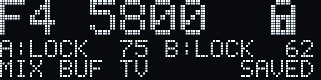

Rad 1 är dubbelhög (10 tecken): band och kanal, MHz, `!` om kanalen ligger utanför 5725–5875 MHz, hänglås när kanalspärren är på. Rad 3: dekoderstatus per mottagare (`LOCK`, `NOSIG`, `----` = svarar inte på I2C) och kalibrerad RSSI (` --` okalibrerad, `  ?` ingen avläsning). Rad 4: mixläge, latensläge, filter och sparstatus.

Sparstatusen kommer från flashlagret (`flash_store.v` fick två nya utgångar, `dirty` och `stored`), inte från en timer:

| Text | Betyder |
|---|---|
| `SAVED` | flashen har en post med exakt de här inställningarna |
| `UNSAVED` | något är ändrat; posten skrivs 3 s efter sista ändringen och läses tillbaka innan texten byter |
| `SAVE ERR` | en skrivning lästes inte tillbaka rätt |
| `DEFAULTS` | flashen har ingen post och inget är ändrat (standardvärdena gäller) |
| (tomt) | startavläsningen av flashen är inte klar (första 10 ms) |

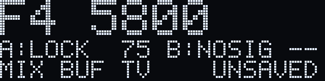
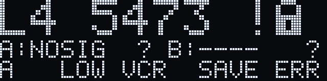

Knapparna i flygvyn: ▲ öppnar menyn, ▼ bläddrar till informationssidorna (mätare, RSSI, tillbaka). Ingen knapp i flygvyn ändrar kanalen.

## Menyn: en post per skärm

▼ går till nästa post, efter sista posten tillbaka till flygvyn. ▲ ändrar posten. Rad 3 säger vad värdet betyder, rad 4 vad knapparna gör (`^ CHANGE  v NEXT ITEM`). Efter 15 s utan knapptryck går menyn tillbaka till flygvyn av sig själv (inte under en skanning).

| | |
|---|---|
| 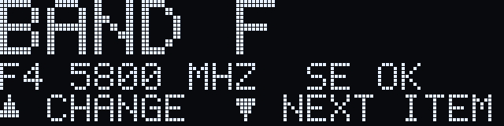 | 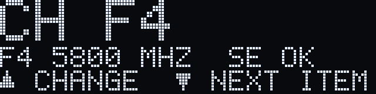 |
| 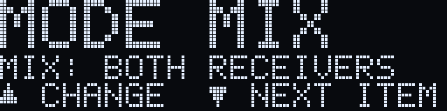 | 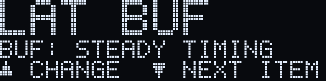 |
| 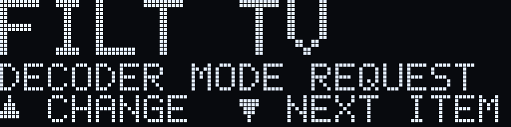 | 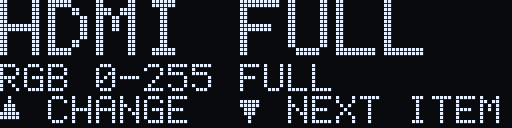 |
| 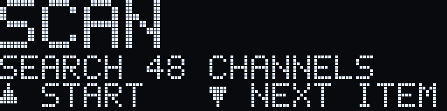 | 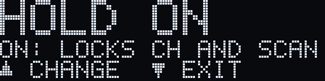 |

- **BAND, CH**: som förut, men varje byte syns stort. Rad 3 visar kanal, MHz och om den ligger i SE-bandet.
- **MODE** MIX / A / B och **LAT** BUF / LOW: oförändrade regler, texten på rad 3 förklarar dem med ord i stället för förkortningar.
- **FILT** TV / VCR: rad 3 säger `DECODER MODE REQUEST`, för det är en begäran till dekodrarna, inte en återläsning (rådets punkt).
- **HDMI** FULL / LTD: i DVI-bygget (standard) står `HDMI N/A`, rad 3 `DVI BUILD: NO EFFECT`, och NEXT gör inget. Toppen talar om för menyn vilket bygge det är.
- **SCAN**: ▲ startar; under skanningen står `SCANNING`, kanalen som provas och `ANY BUTTON ABORTS`. Hittas en kanal slutar menyn i flygvyn med den nya kanalen. Hittas ingen står `SCAN NONE` / `NO LOCKED CHANNEL` till nästa knapp. Ett avbrott lämnar SCAN-skärmen som den var (förut visade den `NONE` även efter avbrott).
- **HOLD** (ny, rådets `CH HOLD`): ON gör BAND, CH och SCAN döva; rad 4 på de posterna säger `HOLD IS ON`, flygvyn visar hänglåset. Spärren sparas inte i flashen och är av efter start. Den vet inget om armering eller flygning; den skyddar mot oavsiktliga tryck.

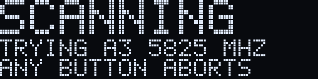
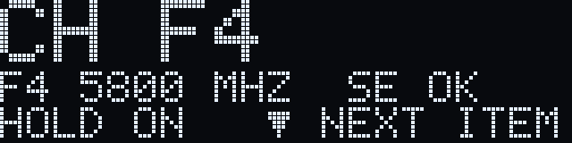
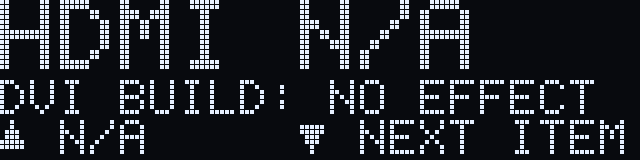

## Informationssidorna

Mätarsidan och RSSI-sidan är kvar i enkel text (de är diagnostik). På RSSI-sidan slår ▲ kalibreringen av och på (förut: OK till fältet CAL, sedan NEXT); att lämna sidan (▼) avslutar den som förut.

| | |
|---|---|
| 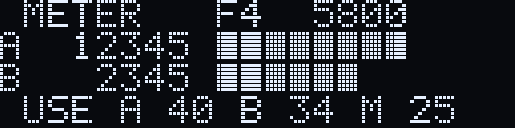 | 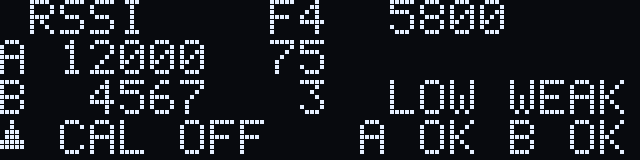 |

## Till jämförelse: huvudsidan i dag

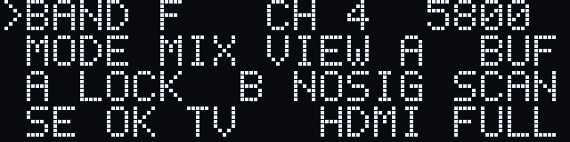

## Vad som ändrats i Core (grenen `ui/flight-view`)

- `rtl/ssd1306_text.v`: `text_big` ritar ett radpar dubbelt (12 pixlar per cell, varje glyfkolumn och glyfrad två gånger, övre sidan glyfrad 0–3, undre 4–6). Ingen bildbuffert, som förut.
- `rtl/puck_ui.v`: sidorna flygvy / mätare / RSSI / meny, en post per skärm, HOLD, menytimeout, sparstatus; parametrar `MENU_MS` och `HDMI_BUILD`. Loggraden över USB är oförändrad (87 byte).
- `rtl/flash_store.v`: utgångarna `dirty` och `stored`. `top/m6_puck_proto.v` kopplar dem och `HDMI_BUILD`.
- `model/font5x7.py`: glyferna `?`, `@` (hänglås), `J`, `Q`. `model/oled_ref.py`: sidbyten, avkodning och PNG.
- Tester: `sim/test_puck_ui.py` (flygvy byte för byte mot modellen, meny, HOLD, timeout, avbruten och hel skanning, flashladdning, OSD, logg; negativa kontroller: HDMI-steget, skärmen, loggen, sparstatus alltid `SAVED`, enkelhög rad, HOLD utan verkan, ingen timeout; DVI-bygget), `sim/test_flash_store.py` (sparstatus mot schemat, tre negativa kontroller).
- OSD:n i videon visar samma tecken i en storlek; den dubbelhöga raden blir rad 1 i OSD:n, rad 2 tom.

## Öppet för ägaren

1. Utseendet: texterna på rad 3 och 4, om `SAVED`-statusen ska stå i flygvyn eller bara i menyn, om `HOLD` behövs. (Knappnamnen: besvarat 2026-10-20, pilar.)
2. Timeouten 15 s: för kort eller för lång.
3. Om OSD:n också ska rita stort (kräver en skalningsändring i `osd_overlay.v`).
4. Sammanslagning av grenen efter svaret; hela sviten och M6-byggena körs före.
