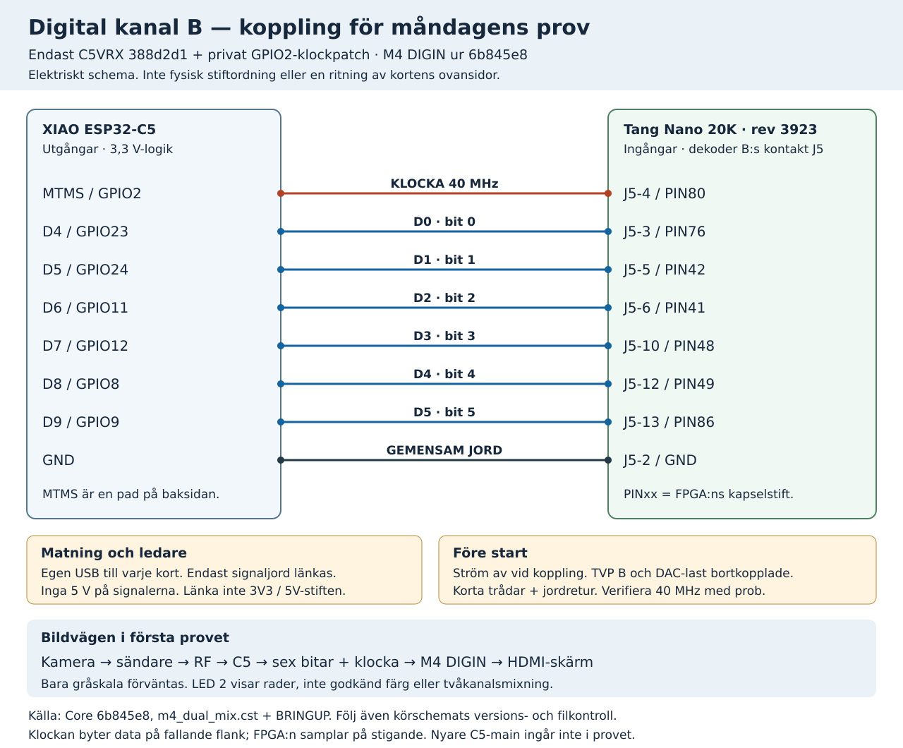

# Måndag 26 oktober: C5VRX direkt till Tang Nano 20K

Första målet är en stabil **svartvit kamerabild från digital kanal B**, med det C5-bygge och den M4-bitström som redan finns. Därefter jämför vi med analogvägen. Vi köper eller portar ingen ny FPGA för att genomföra detta prov.

**Provet är låst till C5VRX `388d2d1` + den privata GPIO2-klockpatchen från 24 oktober och Core `6b845e8`. Senaste C5VRX-main ingår inte.** Nyare firmware får inte ersätta provbygget under passet. Pinändringen i nyare main hör till en framtida integration, se sist i dokumentet.

Planen är granskad 2026-10-25 mot källor och sparad bitström. Kopplingen och digitalingången är ännu inte provade på kortet. Detta är ett körschema, inte ett kvitto på utförd mätning.

## 1. Lägg fram på bänken

| Behövs nu | Användning |
|---|---|
| Tang Nano 20K, bänkkortet rev 3923 | Samma kort som har visat M0 och kamerabild. Kontrollera revision; flytta inte tabellen till en annan revision utan schemajämförelse. |
| XIAO ESP32-C5 med 5,8 GHz-antenn | Mottagare med det privata bygget från 24 oktober. |
| Kamera + sändare + rätt antenn och matning | NTSC, samma kanal på sändare och C5. F4/5800 MHz är utgångsläget om den befintliga riggen använder det. |
| HDMI-skärm som redan visat M0, HDMI-kabel | Första provet är vanlig skärm, utan skalare eller XR-adapter. |
| Två USB-datakablar, korta signalledare, lödverktyg, multimeter | Klockledaren till MTMS-paden löds på XIAO:ns baksida. |
| Oscilloskop om det finns; annars snabb logikanalysator | Kontroll av klocka och datanivåer. En vanlig 24 MS/s-analysator kan inte verifiera en 40 MHz-buss. |
| TVP5150-modulen och befintlig DAC-koppling | Lägg åt sidan som återgångsreferens. Behövs inte i första digitala B-provet. |
| HDMI-grabber om den finns | Spara bilder. Avsaknad av grabber stoppar inte första bildprovet. |

Behövs inte nu: RX5808, två C5-moduler, Primer 25K, extern skalare, ny strömförsörjningsdesign eller ett färdigritat Rev B-kort.

## 2. Filerna före lödning och flash

| Del | Låst identitet / kontroll |
|---|---|
| C5-firmware | Kontrollerat via SSH på jobbdatorn 2026-10-25: `C:\Users\lenny\Desktop\Drönare\OpenVRX\bench-logs\c5vrx-clkout-2026-10-24\`. Bas `388d2d17ff5582e698105eb0c1c62c29b8e17d11`, exakt sparad ändring i `main/transport.c` och `main/CMakeLists.txt`; kompileringsposten har `C5VRX_CLK_OUT_GPIO=2`. |
| C5-app SHA-256 | `b0f430404ce3fd9021b5a83fbb36bbaa96759b0d3820cd8f814df3e0d54c5d22` (`c5vrx5.bin`, 1 225 360 byte) |
| Core-källa | `6b845e83706e8c28ff920c4bbddc8d3848ee67c7` |
| Bitströmsgren, fryst revision | `13ee09e62e419f47133312225bd53abdda23947b` i Core, grenen `bench/bitstreams-2026-10-20` |
| Fil | `bitstreams/6b845e8/m4_dual_mix_digin.fs`, med intilliggande `.build.json` |
| Bitström SHA-256 | `5b2f0b9293a504b0fa1f2a4e068d685c4232255c3b28d9878e5fc44d897b4550` |
| Byggval | `DIGIN=1`, `IOREG=0`, `LOW=0` (BUF), `HDMI=0` (DVI), `VINTERP=0`, seed 0, frekvenskrav 75 MHz. |

Den 25 oktober stämde bitströmmens 7 261 470 byte mot manifestet och samtliga **58 deklarerade källindata** mot Git-revisionen ovan. Manifestets `git.commit` och `git.dirty` är `null`; grennamnet ensamt är alltså inte en källidentitet. Övriga byggutdata har inte verifierats på nytt. Ingen ny byggkörning behövs för detta bänkprov.

### C5-paketet är nu filkontrollerat på jobbdatorn

[Filkvittot från 25 oktober](C5_PACKAGE_FILE_REVIEW_2026-10-25.json) binder de tre binärerna. Alla stämde både med paketets `SHA256SUMS` och med kopiorna i `/root/esp/c5vrx-build/build/` i Ubuntu/WSL. Appens inbäddade metadata anger `c5vrx5`, `5.0.0-dev`, ESP-IDF `v6.0.2`, byggd 24 oktober kl. 14:42:56 enligt byggmetadata. Versionstexten ensam är alltså inte binärens identitet.

Källträdet `/tmp/c5vrx-src` står på exakt `388d2d17ff5582e698105eb0c1c62c29b8e17d11`; dess diff mot HEAD är byteidentisk med paketets `tree.diff`, och omfattar bara de två filerna ovan. Den sparade kompilatorposten för `transport.c` anger samma revision med `-dirty` och `-DC5VRX_CLK_OUT_GPIO=2`. Appen ryms i den faktiska factory-partitionen på `0x10000` (3 MiB). Det är en kontroll av befintliga filer och byggposter, inte ett nytt reproducerat bygge eller en uppmätt 40 MHz-klocka.

| Fil | SHA-256 |
|---|---|
| `bootloader.bin` | `92163cda491e3e2a553a4806bea1d5894364ab937b51e5394960aa0c1605df3a` |
| `c5vrx5.bin` | `b0f430404ce3fd9021b5a83fbb36bbaa96759b0d3820cd8f814df3e0d54c5d22` |
| `partition-table.bin` | `e4fd61a2e47b7d36e663a40f7a49a0b9fbbb8b766d0f7a78201ae19471d67b75` |

**Liten brist i originalpaketet:** `flash_command.txt` innehåller `write-flash "@flash_args"`, men `flash_args` finns inte i paketmappen. Kör inte den raden där. Den kompletta argumentfilen finns bara i WSL-byggmappen `/root/esp/c5vrx-build/build/flash_args` och har sökvägar relativt just den mappen.

För måndagens befintliga C5-installation används paketets dokumenterade **appbyte** i Chrome/webbflasharens `Local File`: välj ovanstående `c5vrx5.bin`, adress **`0x10000`**. Originalets README anger oförändrad bootloader och partitionstabell mot den befintliga officiella 5.0.402-installationen. Det befintliga innehållet i kortets flash har **inte** lästs via SSH; bekräfta därför att den installationen fortfarande är utgångsläget. Om den är okänd: använd inte appbyte på antagande, utan kontrollera installationen eller följ paketets kompletta flashinstruktion med dess egna tre filer.

Filer på disken kan kontrolleras igen utan att ansluta eller skriva till kortet, i WSL:

```bash
cd '/mnt/c/Users/lenny/Desktop/Drönare/OpenVRX/bench-logs/c5vrx-clkout-2026-10-24'
sha256sum -c SHA256SUMS
```

### FPGA-filerna finns också redan på jobbdatorn

Båda kopiorna av `m4_dual_mix_digin.fs` kontrollerades över SSH och har exakt den planerade hash som står ovan:

- WSL: `/root/openvrx-wt/digin/gateware/build/m4_dual_mix_digin.fs`, med manifest och de 58 deklarerade källindata verifierade i `/root/openvrx-wt/digin`.
- Windows: `C:\Users\lenny\Desktop\Drönare\OpenVRX\OpenVRX-Core\gateware\build\m4_dual_mix_digin.fs`, med motsvarande manifest.

**Använd de befintliga filerna. Ingen hämtning eller ombyggnad behövs när de fortfarande stämmer.** Skapa bara passets nya loggmapp, `bench-logs/2026-10-26-digital-b/`, från katalogen som innehåller `OpenVRX` och `OpenVRX-Core`.

### Reservhämtning, bara om de kontrollerade FPGA-filerna saknas

Kör i WSL/bash från katalogen som innehåller `OpenVRX` och `OpenVRX-Core`. Kommandona skapar ett separat källträd och en separat bänkkatalog. Finns de redan: kontrollera dem och återanvänd, radera eller skriv inte över dem blint.

```bash
git -C OpenVRX-Core fetch origin bench/bitstreams-2026-10-20
git -C OpenVRX-Core worktree add --detach ../bench-core-digin-6b845e8 6b845e83706e8c28ff920c4bbddc8d3848ee67c7
mkdir -p bench-logs/2026-10-26-digital-b/bitstreams
git -C OpenVRX-Core show 13ee09e62e419f47133312225bd53abdda23947b:bitstreams/6b845e8/m4_dual_mix_digin.fs > bench-logs/2026-10-26-digital-b/bitstreams/m4_dual_mix_digin.fs
git -C OpenVRX-Core show 13ee09e62e419f47133312225bd53abdda23947b:bitstreams/6b845e8/m4_dual_mix_digin.build.json > bench-logs/2026-10-26-digital-b/bitstreams/m4_dual_mix_digin.build.json
```

Kontrollera källor och bitström med befintlig Python, utan installation:

```bash
python3 - <<'CHECK'
import hashlib, json
from pathlib import Path
root = Path('/root/openvrx-wt/digin')
mfile = root / 'gateware/build/m4_dual_mix_digin.build.json'
if not mfile.is_file():
    root = Path('../bench-core-digin-6b845e8')
    mfile = Path('bench-logs/2026-10-26-digital-b/bitstreams/m4_dual_mix_digin.build.json')
m = json.loads(mfile.read_text())
sha = lambda p: hashlib.sha256(p.read_bytes()).hexdigest()
assert m['top'] == 'm4_dual_mix' and m['completed_utc']
assert len(m['inputs']) == 58
assert all(sha(root / f) == h for f, h in m['inputs'].items())
assert sha(mfile.parent / m['bitstream']) == m['artifacts'][m['bitstream']]
assert m['artifacts'][m['bitstream']] == '5b2f0b9293a504b0fa1f2a4e068d685c4232255c3b28d9878e5fc44d897b4550'
assert all(m['options'][k] == v for k,v in dict(digin='1',ioreg='0',low='0',hdmi='0',vinterp='0',seed='0',freq_mhz='75',devcmd='0').items())
print('PASS: bitström + 58 källindata + val; inte full byggartefakt- eller hårdvaruverifiering')
CHECK
```

Om någon kontroll faller: spara felet och hämta rätt originalfiler. Bygg inte om bara för att få ett grönt kvitto.

## 3. Kopplingsschema: endast digital B först



Detta är ett **elektriskt kopplingsschema**, inte en ritning av kortens fysiska stiftordning. J5/J6 är Tang-kortets kontakter; `PINxx` är FPGA-kapselns stiftnummer. Identifiera kontaktens numrering med kortets schema innan lödning. Källor: Core `6b845e8`, `gateware/boards/m4_dual_mix.cst`, och bänkkortets stiftplan i `gateware/BRINGUP.md`.

| Ledare | XIAO ESP32-C5 | Funktion | Tang Nano 20K |
|---|---|---|---|
| K | **MTMS-pad / GPIO2**, baksida | 40 MHz klocka från just provfirmwaren | **J5-4 / PIN80**, `tvpb_sclk` |
| D0 | D4 / GPIO23 | lägsta av de sex videobitarna | J5-3 / PIN76, `tvpb_d[0]` |
| D1 | D5 / GPIO24 | bit 1 | J5-5 / PIN42, `tvpb_d[1]` |
| D2 | D6 / GPIO11 | bit 2 | J5-6 / PIN41, `tvpb_d[2]` |
| D3 | D7 / GPIO12 | bit 3 | J5-10 / PIN48, `tvpb_d[3]` |
| D4 | D8 / GPIO8 | bit 4 | J5-12 / PIN49, `tvpb_d[4]` |
| D5 | D9 / GPIO9 | högsta av de sex videobitarna | J5-13 / PIN86, `tvpb_d[5]` |
| G | GND | gemensam signaljord | J5-2 eller J6-20, GND |

**Inga 5 V på dessa signaler.** Båda korten matas via sina egna USB-portar; koppla gemensam GND, men länka inte deras 3V3- eller 5V-stift. Håll båda korten spänningslösa när du kopplar. Ordna korta ledare, helst under cirka 5 cm som bänkmål, och en närliggande jordretur särskilt till klockan. Längden är en praktisk startpunkt, ingen signalintegritetsgaranti.

Koppla bort TVP B:s data och klocka helt från dessa Tang-stift. Två utgångar får inte driva samma ledare. För det rena digitalprovet kopplas DAC-/kopplingsplattelasten bort från D4–D9; den sparas för referensprovet. Inga extra dataledare behövs till `tvpb_d[7:6]`: digitalgrenen använder bara `[5:0]`. Påstå inte att de är ytterligare två videobitar.

Lämna första provet utan analog kanal A inkopplad. Kanal A och dess kablage återansluts först vid jämförelsen, med strömmen av. Ingen ny pull-up, nivådelskrets eller serieresistor sätts in på chans. Om oscilloskopet visar ringning eller otillräcklig marginal väljs dämpning efter mätningen och dokumenteras som ett separat kopplingsfall.

## 4. Körordning för morgonen

Tiderna är planeringsrutor, inte utlovade bygg- eller mättider. Det går att avsluta efter varje godkänt steg.

### 08:00–08:30 — identifiera och spara referensen

1. Fotografera kortrevision, befintlig koppling och vilken kontakt som är J5. Spara i `bench-logs/2026-10-26-digital-b/`.
2. Hämta och kontrollera filerna i avsnitt 2. C5-paketet finns nu kontrollerat på den angivna jobbdatorsökvägen; läs om `SHA256SUMS` före användning och spara hash, källcommit, patch och flashanvisning med passet. **Om någon fil har ändrats sedan kontrollen: gör bara förberedelser och referensprov tills rätt paket identifierats. Byt inte till senaste main eller webbflasharens standardbygge.**
3. Kontrollera M0 på den vanliga HDMI-skärmen om riggen har flyttats eller bilden är okänd. Det är en kort funktionskontroll av skärm/kabel, ingen ny M0-testkampanj. Minnestestet behöver inte upprepas utan ett nytt feltecken; den digitala M4:n visar eget SDRAM-självtest vid start.
4. Återgången är Tang-kortets befintliga flashbild: kommande laddning är bara SRAM. Koppla bort de digitala ledarna innan du startar en annan bitström med annan stiftfunktion.

### 08:30–09:15 — C5-firmware och fysisk koppling

1. Med Tang frånkopplad: flasha **det befintliga C5-paketet** enligt dess egen anvisning. Appadressen i överlämningen är `0x10000`, men bootloader/partition måste överensstämma med paketet. Använd inte en generisk helflash från annan revision och radera inte NVS på rutin.
2. Bryt C5-strömmen efter flash och starta normalt. Läs `FIRMWARE`/`T` och spara råloggen. En rad som bara visar upstream-commit bevisar inte den privata patchen; behåll binärhash och byggdiff.
3. Ställ samma kanal som sändaren och **synkhjulet av med konsol `U` i detta gamla bygge**. Spara status. Nyare firmware utan synkhjul är inte del av instruktionen.
4. Slå av båda korten, koppla enligt tabellen, kontrollera kontinuitet och att GPIO2 inte kortslutits till granne eller jord. MTMS är en känslig liten pad; kontrollera med förstoring.
5. Starta korten via USB. Kontrollera klockan med högimpediv prob: cirka 40 MHz (25 ns period). Data ska byta på fallande flank och vara stabila runt stigande flank. Vid ideal 50 % duty cycle finns 12,5 ns mellan flankerna, men verklig setup/hold bestäms av fördröjning och ringning. Spara mätbild, inte bara ett frekvenstal.
6. Om klockan saknas: kontrollera patch, binär och bootläge. **Bygg eller flasha inte slumpmässiga alternativ.**

### 09:15–10:00 — första digitala bilden

Efter filkontrollen ovan, ladda M4 till **SRAM**, från WSL/bash i samma arbetskatalog:

```bash
python3 OpenVRX/tools/bench/bench.py flash /root/openvrx-wt/digin/gateware/build/m4_dual_mix_digin.fs
```

Verktyget kontrollerar bitström mot manifest och använder `openFPGALoader -b tangnano20k` utan `-f`. Det verifierar också övriga byggartefakter om samtliga finns bredvid bitströmmen; annars blir nivån `bitstream`. Den separata 58-filerskällkontrollen ovan behövs också. Om reservhämtningen användes, byt filsökvägen i kommandot till `bench-logs/2026-10-26-digital-b/bitstreams/m4_dual_mix_digin.fs`. **Använd inte `--root` med bara reservhämtningens två filer:** manifestverktyget kräver då även alla övriga byggartefakter som inte följer med bänkgrenen. Inga kontroller ska stängas av med `--no-verify`.

- Vänta först ut SDRAM-självtestets cirka tre sekunders LED-visning. Därefter betyder LED 2 att B avkodar rader. LED 0 visar TVP-status och kan blinka snabbt trots aktiv digital B.
- Bilden förväntas vara **gråskala**, med svart sidyta för 4:3-bilden i 720p. Avsaknad av färg är inte ett fel i denna etapp.
- Visa en klocka eller flytta handen framför kameran; en stillbild räcker inte för att skilja levande video från fryst fältminne.
- Kör fem minuter med stark, stabil länk. Anteckna rullning, frysningar, svarta avbrott, horisontell förskjutning och synligt mönster. Spara en kort film eller bildserie.
- Ingen M6-UART, B-fältdump eller menystyrning är ett krav här: **den aktuella digitala toppen är M4**.

**Första etappen godkänd:** rätt binärer, mätt klocka, LED 2 visar radaktivitet och en levande svartvit kamerabild utan fortlöpande rullning under fem minuter. Detta godkänner inte färg, LOW-latens, tvåkanalsmixning eller svagsignalskvalitet.

### 10:00–10:45 — jämför samma mottagare genom två vägar

Kör först den tidigare dokumenterat fungerande analoga riggen, sedan digital B, sedan analogt igen. Återställ den analoga kopplingen och dess egen bitström enligt den gamla bänknoten; koppla aldrig TVP-utgången till en aktiv C5-utgång.

Samma kamera, kanal, antennplacering, ljus och C5-inställningar i alla tre körningar. Den digitala och analoga vägen kan ha olika skalning och gain; ett lägre HF-/snövärde ensamt bevisar inte bättre känslighet, eftersom ett filter också tar bort detaljer.

Om grabber finns:

```powershell
tools\bench.ps1 cameras
tools\bench.ps1 capture -Device "<grabberns namn>" -Frames 30 -Interval 0.5
```

Kommandona körs från `OpenVRX` på Windows. Mät de sparade bilderna i WSL med `tools/bench/quality.py measure <katalog> --out report.json --sheet sheet.png`. För digital B jämförs luma, synkbortfall och detalj; **inte färgfel**, eftersom Cb/Cr är 128. Analogprovets M6-dumpar kan användas separat, men det finns ännu ingen motsvarande digital B-dump.

### 10:45–11:15 — avbrott och återlåsning

Filma skärmen kontinuerligt: 20 s bild, sändaren av 5 s, sedan på. Gör tre gånger med samma inställningar. Anteckna tid till levande bild efter återkomst och om bilden fryser/rullar. BUF kan hålla gammalt fält; detta ska loggas som fryst bild, inte som fungerande mottagning. En separat C5-USB-omstart är ett eget prov, eftersom transportklockan också kan stanna.

### Efter lunch — bara om förmiddagens mål är klart

1. Sammanfatta bild och klockmätning till Twotoz som **utkast**: firmwarehash, patch, sex bitar, klocka/flank, ledningslängd, NTSC, stopp/återstart och resultat. Skicka först på ägarens uppdrag.
2. Mät latens om rätt rigg finns, enligt [skalningsjämförelsen](../../research/HDMI_SKALNING_PRIMER_25K_2026-10-25.md). Gör inget inköp utifrån en omätt siffra.
3. Välj nästa utvecklingsuppgift: verkliga C5-sampel i referensmodellen och därefter färgavkodning. Upprepa inte gamla helsviter eller routningar utan en kodändring eller ny konkret täckningsfråga.

## 5. Två integrationsluckor före ett riktigt A/B-mixerprov

Detta är källfynd, inte åtgärdade produktionsfel:

- **Digital B:s hälsostatus:** i `6b845e8` och läst Core-main går fortfarande `nolock_b` från TVP-status via `ext_bad_b` till `mix_chan`, även med `B_DIGITAL=1`. Utan TVP B blir den statusen dålig. En ensam B kan ändå visas enligt mixerns regler, men den är inte därmed en frisk diversity-kanal och kan förlora mot A. LED 2 bevisar bara radaktivitet. Före tvåkanalsgodkännande behövs ett eget granskat kontrakt och test för digital B:s sync-/hälsostatus; tvinga inte TVP-OK eller ändra mixerns skyddsregel för att få bild.
- **Mätutgång:** `DIGIN` är kopplad i M4. M6:s fältdump tappar dekoder A respektive mixerutström, inte en ny direkt digital B-tapp. B-dump och parningsmätning är separat arbete. Anta inte att befintliga M6-kommandon styr M4.

## 6. Stopp och återgång

| Tecken | Gör först | Gör inte |
|---|---|---|
| Ingen 40 MHz | Kontrollera det gamla provpaketet, pad och bootläge | Byt till ny main eller nytt GPIO på chans |
| Ingen bild, LED 2 släckt | Kontrollera bitordning, kanal/NTSC, flank och klocka på Tang-sidan | Dra slutsatsen att SDRAM eller RF-kretsen är trasig |
| LED 2 lyser men ingen/trasig bild | Spara film/status, kontrollera A helt frånkopplad och dokumentera hälsogrinden ovan | Kalla LED-resultatet godkänt bildprov |
| Instabilitet efter extra ledare | Gå tillbaka till korta digitala ledare utan DAC-last | Ändra gain, firmware, bitström och kablage samtidigt |
| USB-loggen tyst | Spara råfel, stäng andra terminaler, bryt ström och använd tidigare fungerande konsolväg | Räkna tyst logg som ett videobevis |

Stäng av före omkoppling. Tang-laddningen är till SRAM så flashbilden bevaras. C5 återgår genom sitt sparade tidigare firmwarepaket. Inga inställningar ska raderas för att göra återgången enklare.

## 7. Protokoll att fylla i

| Fält | Resultat |
|---|---|
| Datum, operatör, kortrevision, foto | |
| C5 binär SHA-256 / patch / `FIRMWARE` | |
| Core-bitström SHA-256 / källkontroll | |
| Kanal / NTSC / C5-outputnivå / synkhjul av | |
| Klocka vid C5 / vid PIN80 / prob och instrument | |
| Dataflank / ledningslängd / jordretur | |
| SDRAM-startvisning / B-LED efter 3 s | |
| Fem minuter levande gråskalebild / avbrott | |
| Analog–digital–analog, bild- och loggmappar | |
| Tre signalbortfall / tid till levande bild | |
| Latensmetod, spridning och osäkerhet, om mätt | |
| Nästa enda uppgift / eventuell blockering | |

## 8. Nyare C5VRX — endast inför framtida uppdatering

PR [#257](https://github.com/Twotoz/C5VRX/pull/257) har en officiell valbar klockutgång, men dagens main efter [#263](https://github.com/Twotoz/C5VRX/pull/263) använder GPIO2 till IQ. De får inte kombineras utan en ny pinlösning. Detta **ändrar inte kopplingen för måndagens frysta bygge**. Dess gamla `U`-instruktion gäller bara det gamla bygget. Åtta verkliga utgångsbitar är fortfarande framtida arbete; fler GPIO:er skapar inte i sig fler informationsbitar.
