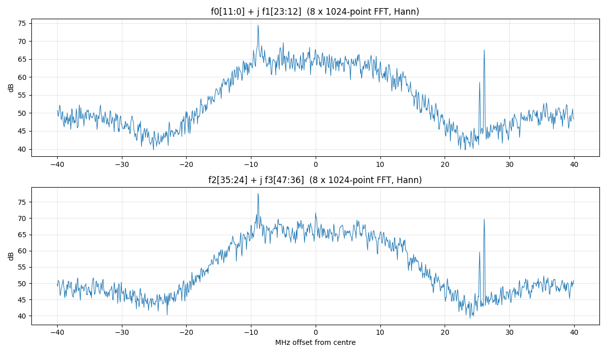
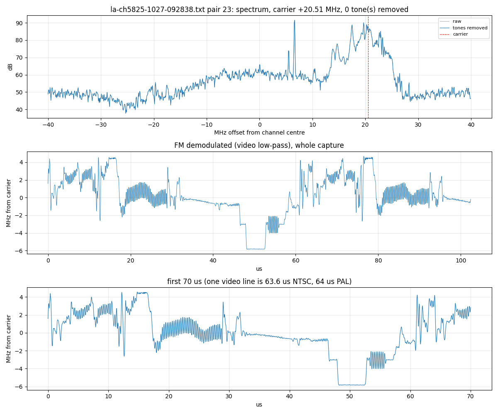

# Uppgift 70, resultat 2026-10-27: RTL8852BE ser analog FPV-video

Nådd nivå enligt [uppdraget](OPI5_RTL8852BE_2026-10-26.md), avsnitt 7: **2, korta råfångster fungerar.** Signalen är identifierad I/Q, FM-demodulering ger NTSC-rader med bildinnehåll från ägarens VTX. Ingen kontinuerlig ström, ingen bild på HDMI. Mätt på hårdvara 2026-10-26 16:33 till 2026-10-27 09:30, jobbdatorn över SSH.


Bild 1: fångsten `la-cap-1027-085515` (102 µs, 80 MHz-blocket med mitt 5 775, sändaren vikt in av samplingen). Platt nivå, synkpuls 2,8 MHz under den i 4,7 µs, färgburst direkt efter, nästa synk 63,6 µs senare.

## Uppställning

- Orange Pi 5, 8 GB, ägarens färdiga SD-kort: Armbian 26.8.1 trixie, kärna 6.1.115-vendor-rk35xx, RAM-hålet `badram@171010000` aktivt i `/proc/iomem`. Enda ändringen på kortet: SSH-nycklar i `authorized_keys` för `dietpi` och `root`, skrivna som sju verifierade 4 MiB-block; originalet ligger som `/root/opi-sd.img` i jobbdatorns WSL.
- LCL RTL8852BE `[10ec:b852]` på PCIe Gen1 x1 via M.2 A/E→M. Antennen sitter på väg B (fälten f2/f3) att döma av effekten med sändaren på.
- Drivrutin: `lwfinger/rtw8852be` `52f1fa3`, byggd på Pi:n mot linux-headers-vendor-rk35xx 26.8.3 med `CONFIG_PROC_DEBUG = y`, `EXTRA_CFLAGS += -DDBG_LA_MODE` och `CONFIG_WIFI_MONITOR = y` (patcharna i `/root/openvrx-rtl8852be/logs/`), laddad med `rtw_la_mode_en=1` efter att `rtw89_8852be/8852b/pci/core` lastats ur. Källan ligger utanför repona.
- Modulen lastas aldrig ur: `rmmod 8852be` hängde kärnan 2026-10-26 16:55 (RCU-stall på CPU 6 och 7, sshd dog, strömbrytning krävdes). Byte av bygge görs med omstart och en laddning per start.
- Monitorläge: `iw dev wlP4p65s0 set type monitor` före `ip link set up`, sedan `iw dev wlP4p65s0 set freq <MHz>`; `/proc/net/rtl8852be/wlP4p65s0/rf_info` visar kanalen. Radion ger 5 500 till 5 825 MHz i 20 MHz-steg (kanal 100 till 165) samt 40- och 80 MHz-block; 5 725 avvisas tyst, så kanalen ska alltid läsas tillbaka.

## Fångstvägen (fas B)

Kommandon till `/proc/net/rtl8852be/wlP4p65s0/odm/phl_cmd`, en trigglös fångst:

```
bb lamode reset
bb lamode buf 0                  # 64 KiB = 8 192 ord, det enda alternativet på 8852B cut B eller senare
bb lamode cmn 404 0 10205 0 0    # dbg-port 0x10205, positiv flank, klockindex 0 = 80 MHz
bb lamode tmac 1 0               # MAC-timeout 1 s stoppar ringfångsten
bb lamode trig                   # pollraden med rpt=((0x3)) ger finish_ofst och round_up
bb lamode get <finish_ofst> <round_up>
bb lamode print 0                # 8 192 rader "[BB]<16 hex>" till dmesg, 68 ms, inga tappade rader
```

`set 1 1` är inte fejktrigg utan "not stop trig" och ger tom dump. Dumpen läses med `dmesg -w` till fil på Pi:n. Ordformat (DMA-typ 1 i `halbb_la_mode.h`): bit 47 till 0 är fyra 12-bitars signerade fält, (f0, f1) = I/Q väg A och (f2, f3) = I/Q väg B (korrelation 0,18 mellan vägarna i brus, 0 mellan I och Q); bit 63 till 48 är noll. Klockindex 0 ger 80 MHz, bekräftat med radtakten nedan: en fångst är 102 µs. Ringbuffertens skarv är kontrollerad utan fashopp.

Lägre klockindex (2 = 20 MHz) decimerar utan filter: en stark signal utanför ±10 MHz viks in i bandet. Sådana fångster gav först fel bärarfrekvens och ska inte användas förrän signalen ligger inom kanalen.

Brus utan sändare: standardavvikelse 35 till 45 LSB av ±2 047 per fält; mottagarens egna toppar, oberoende av LO, vid 5 796,1, 5 800, 5 801,5, 5 805 (DC), 5 811,2 och 5 830,5/5 831,5 MHz.



Bild 2: brus utan sändare på kanal 161 (5 805) med 20 MHz kanalbredd och 80 MHz sampling, båda vägarna. Passbandet är kanalfiltret, topparna är mottagarens egna.

`bb psd` ger värdet 101 i alla 512 punkter och är oanvändbar som den är.

## Analog RF (fas C)

- Kameran på (ägaren 08:55, kanal okänd för ägaren): effekten steg 13 dB i väg B. Sändaren ligger **ovanför radions översta kanal**: på kanal 165 (LO 5 825) med 80 MHz sampling syns den som en bred FM-puckel vid +12 till +26 MHz i kanalfiltrets flank, med släckningsnivån vid +18,0 (09:12) till +19,5 MHz (09:28), alltså 5 843 till 5 844,5 MHz: **R6 (5 843)**, möjligen A2 (5 845). På kanal 161 (LO 5 805) finns ingen puckel, så den är verklig RF och inte en spegelbild. Vad kanalen heter på sändaren är inte verifierat.
- Demodulering (momentanfrekvens efter bandbegränsning, `la_fm.py`): synkpuls 374 till 388 sampel vid 80 MHz (4,7 µs), radavstånd 5 084 till 5 085 sampel (63,55 µs), färgburst 3,58 MHz: **NTSC**. Bild 1 är en nästan tom bild (synkdjup 2,8 MHz), bild 3 har bildinnehåll och kroma. Synk- och radtakten mättes i sampel (`la_lines.py`) i fyra fångster med samma värden.
- Alla tidigare värden från 20 MHz sampling (bärare "5 820", ton "5 822") var vikningar av samma signal och är strukna; de står kvar i bänkloggen som lärdom.



Bild 3: fångsten `la-ch5825-1027-092838` (102 µs). Överst spektrumet: puckeln vid +12 till +26 MHz är videosändaren, de smala topparna vid +5,5 och +6,6 MHz mottagarens egna. Under: en hel rad med synk, färgburst, bakre platå och bildinnehåll med kroma.

## Vad som inte är visat

- Ingen kontinuerlig ström: 64 KiB per fångst och minst en sekund per omgång (timeout, pollning, utskrift). Fas D och E är inte påbörjade.
- Sändaren inom kanalen: alla fångster togs i filterflanken eller vikta. En VTX-kanal inom 5 500 till 5 825 MHz (F4 5 800, R5 5 806, A4 5 805 eller lägre) ger ett rent prov; det kräver att ägaren kan byta kanal på sändaren.
- Ingen siffra för ADC-upplösning eller ENOB; "12 bitar" är fältbredden i ordet.
- Kraschloggen från 16:55: pstore tömdes av strömbrytningen. Nästa gång: Alt+SysRq+B från ett tangentbord i Pi:n bevarar ramoops.

## Filer

- Råfiler, loggar och bilder: `bench-logs/2026-10-26-digital-b/` på jobbdatorn, utanför repona; `NOTES.md` där har hela förloppet med tider, `SHA256SUMS-opi5.txt` hashar alla fångster. Tre nycklar: `la-cap-1027-085515.txt` (bild 1) `0b725f0594284811…`, `la-ch5825-1027-092838.txt` (bild 3), `la-cap-1027-084626.txt` (bild 2) `0011df0bd5db273c…`.
- Skript hos agenten (scratchpad, flyttas till `tools/` om spåret fortsätter): `opi_swap.sh` (drivrutinsbytet steg för steg med spärrar), `opi_la_remote.sh` (`cap2`, `chan`, `sweep`, `cap20` på Pi:n), `opi_fetch.sh`, `la_decode.py` (ordstruktur), `la_fm.py` (spektrum och FM), `la_lines.py` (radtakt i sampel), `la_join.py` (skarvkontroll).
- Återgång: omstart av Pi:n ger `rtw89` tillbaka; inget i `/boot` är ändrat. Installerat på Pi:n: linux-headers-vendor-rk35xx 26.8.3, make, git, flex, bison, libssl-dev.

## Nästa uppgift

Fas D som mätning, med sändaren på en kanal inom radions band: hur tätt 64 KiB-fångster kan tas (`max_num` med drivrutinens 500 ms-timer, eller egen slinga) och hur stora luckorna är, tidsstämplade ur radsynken. Blir kadensen sekunder per fångst är LA-vägen en mätprobe och inte en mottagare, och spåret pausas med det beskedet.
