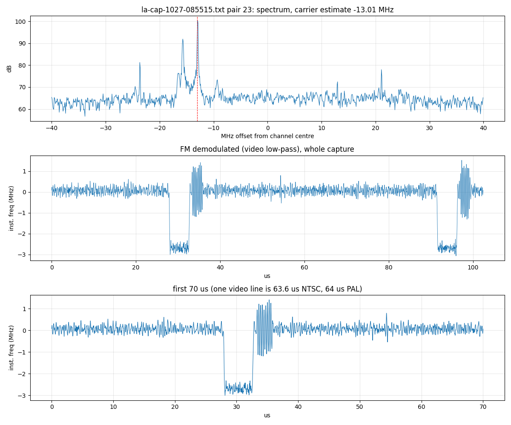
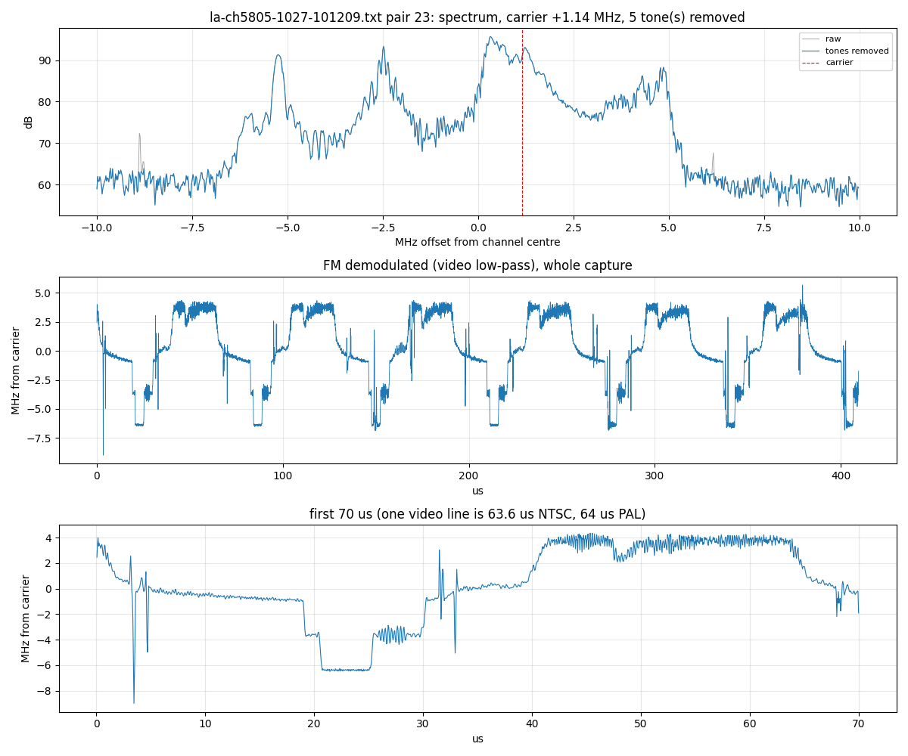

# Uppgift 70, resultat 2026-10-27: RTL8852BE ser analog FPV-video

Nådd nivå enligt [uppdraget](OPI5_RTL8852BE_2026-10-26.md), avsnitt 7: **2, korta råfångster fungerar.** Signalen är identifierad I/Q, FM-demodulering ger NTSC-rader med bildinnehåll från ägarens VTX. Ingen kontinuerlig ström, ingen bild på HDMI. Mätt på hårdvara 2026-10-26 16:33 till 2026-10-27 09:30, jobbdatorn över SSH.



Bild 1: fångsten `la-cap-1027-085515` (102 µs, 80 MHz-blocket med mitt 5 775, sändaren vikt in av samplingen). Platt nivå, synkpuls 2,8 MHz under den i 4,7 µs, färgburst direkt efter, nästa synk 63,6 µs senare.

## Uppställning

- Orange Pi 5, 8 GB, ägarens färdiga SD-kort: Armbian 26.8.1 trixie, kärna 6.1.115-vendor-rk35xx, RAM-hålet `badram@171010000` aktivt i `/proc/iomem`. Enda ändringen på kortet: SSH-nycklar i `authorized_keys` för `dietpi` och `root`, skrivna som sju verifierade 4 MiB-block; originalet ligger som `/root/opi-sd.img` i jobbdatorns WSL.
- LCL RTL8852BE `[10ec:b852]` på PCIe Gen1 x1 via M.2 A/E→M. Antennen sitter på väg B (fälten f2/f3) att döma av effekten med sändaren på.
- Drivrutin: `lwfinger/rtw8852be` `52f1fa3`, byggd på Pi:n mot linux-headers-vendor-rk35xx 26.8.3 med `CONFIG_PROC_DEBUG = y`, `EXTRA_CFLAGS += -DDBG_LA_MODE` och `CONFIG_WIFI_MONITOR = y` (patcharna i `/root/openvrx-rtl8852be/logs/`), laddad med `rtw_la_mode_en=1` efter att `rtw89_8852be/8852b/pci/core` lastats ur. Källan ligger utanför repona.
- Modulen lastas aldrig ur: `rmmod 8852be` hängde kärnan 2026-10-26 16:55 (RCU-stall på CPU 6 och 7, sshd dog, strömbrytning krävdes). Byte av bygge görs med omstart och en laddning per start.
- Monitorläge: `iw dev wlP4p65s0 set type monitor` före `ip link set up`, sedan `iw dev wlP4p65s0 set freq <MHz>`; `/proc/net/rtl8852be/wlP4p65s0/rf_info` visar kanalen. Radion ger 5 500 till 5 825 MHz i 20 MHz-steg (kanal 100 till 165) samt 40- och 80 MHz-block; 5 725 avvisas tyst, så kanalen ska alltid läsas tillbaka.

## Fångstvägen (fas B)

Kommandon till `/proc/net/rtl8852be/wlP4p65s0/odm/phl_cmd`, en trigglös fångst:

```
bb lamode reset
bb lamode buf 0                  # 64 KiB = 8 192 ord, det enda alternativet på 8852B cut B eller senare
bb lamode cmn 404 0 10205 0 0    # dbg-port 0x10205, positiv flank, klockindex 0 = 80 MHz
bb lamode tmac 1 0               # MAC-timeout 1 s stoppar ringfångsten
bb lamode trig                   # pollraden med rpt=((0x3)) ger finish_ofst och round_up
bb lamode get <finish_ofst> <round_up>
bb lamode print 0                # 8 192 rader "[BB]<16 hex>" till dmesg, 68 ms, inga tappade rader
```

`set 1 1` är inte fejktrigg utan "not stop trig" och ger tom dump. Dumpen läses med `dmesg -w` till fil på Pi:n. Ordformat (DMA-typ 1 i `halbb_la_mode.h`): bit 47 till 0 är fyra 12-bitars signerade fält, (f0, f1) = I/Q väg A och (f2, f3) = I/Q väg B (korrelation 0,18 mellan vägarna i brus, 0 mellan I och Q); bit 63 till 48 är noll. Klockindex 0 ger 80 MHz, bekräftat med radtakten nedan: en fångst är 102 µs. Ringbuffertens skarv är kontrollerad utan fashopp.

Lägre klockindex (2 = 20 MHz) decimerar utan filter: en stark signal utanför ±10 MHz viks in i bandet. Sådana fångster gav först fel bärarfrekvens och ska inte användas förrän signalen ligger inom kanalen.

Brus utan sändare: standardavvikelse 35 till 45 LSB av ±2 047 per fält; mottagarens egna toppar, oberoende av LO, vid 5 796,1, 5 800, 5 801,5, 5 805 (DC), 5 811,2 och 5 830,5/5 831,5 MHz.


Bild 2: brus utan sändare på kanal 161 (5 805) med 20 MHz kanalbredd och 80 MHz sampling, båda vägarna. Passbandet är kanalfiltret, topparna är mottagarens egna.

`bb psd` ger värdet 101 i alla 512 punkter och är oanvändbar som den är.

## Analog RF (fas C)

- Kameran på (ägaren 08:55, kanal okänd för ägaren): effekten steg 13 dB i väg B. Sändaren låg då **ovanför radions översta kanal**: på kanal 165 (LO 5 825) med 80 MHz sampling syntes den som en bred FM-puckel vid +12 till +26 MHz i kanalfiltrets flank, synktoppen vid 5 840 till 5 842 MHz. På kanal 161 (LO 5 805) fanns ingen puckel, så den var verklig RF och inte en spegelbild. Med sändarens frekvenskonvention nedan var kanalen troligen F6 (5 840).
- Demodulering (momentanfrekvens efter bandbegränsning, `la_fm.py`): synkpuls 374 till 388 sampel vid 80 MHz (4,7 µs), radavstånd 5 084 till 5 085 sampel (63,55 µs), färgburst 3,58 MHz: **NTSC**. Bild 1 är en nästan tom bild (synkdjup 2,8 MHz), bild 3 har bildinnehåll och kroma. Synk- och radtakten mättes i sampel (`la_lines.py`) i fyra fångster med samma värden.
- 10:11, sändaren satt på **F4 (5 800)** av ägaren och kontrollerad i Moneagle-glasögonen: på kanal 161 (LO 5 805) ligger hela signalen i kanalen, 25 dB över bruset i båda vägarna. Spektrumets fyra puckar är videonivåerna: synktopp −5,3, släckning +0,6 och vitt +4,9 MHz från LO, alltså synktoppen vid 5 799,7 MHz: kanalnumret är synktoppens frekvens hos den här sändaren, deviation synk till vitt cirka 10 MHz. Fångsten med 20 MHz sampling (index 2, 410 µs) ger **6,4 rena rader** med synk, burst, bakre platå och ett ljust parti i bilden (bild 4). Väg A klipper vid ±2 047, väg B inte: ingen AGC-verkan i det här läget med sändaren nära.
- Alla tidigare värden från 20 MHz sampling med sändaren utanför kanalen (bärare "5 820", ton "5 822") var vikningar och är strukna; de står kvar i bänkloggen som lärdom. Klockindex 1 (40 MHz) ger motsägande tider i alla prov och används inte.


Bild 3: fångsten `la-ch5825-1027-092838` (102 µs). Överst spektrumet: puckeln vid +12 till +26 MHz är videosändaren, de smala topparna vid +5,5 och +6,6 MHz mottagarens egna. Under: en hel rad med synk, färgburst, bakre platå och bildinnehåll med kroma.



Bild 4: fångsten `la-ch5805-1027-101209` (410 µs) med sändaren på F4. Överst spektrumet med videonivåerna som puckar. Under: 6,4 rader, var och en med synk, burst, bakre platå och det ljusa partiet.

## Kontinuitet (fas D), 10:25 till 10:30

Drivrutinen skriver inte ut automatiskt (`is_la_print` används aldrig) och hämtar inte bufferten i timeout-vägen, så `max_num` ger inget. Varje fångst drivs från användarrymden: `reset`, `buf 0`, `cmn`, `tmac` eller `mac`, `trig`, `get` vid timeout, `print 0`, vänta på `Dump_End`. Skriptet tar tid per steg och läser kärnans tidsstämpel för stoppet (`la_remote.sh cad`, loggar `opi5-cadence-*.txt`, fångsterna `la-cad-*.txt`).

| Stopp | Fångster | `trig` | Per fångst i skriptet | Stopp till stopp i kärnan | Fulla buffertar |
|---|---:|---:|---:|---:|---:|
| MAC-timeout 1 s, ingen trigg | 8 | 1,10 s | 1,20 till 1,33 s | 1,39 till 1,51 s | 8 av 8 |
| MAC-trigg CCA (`mac 0 1 0 0`), trigtid 404 µs | 20 | 0,14 s | 0,21 till 0,34 s, medel 0,23 | 0,40 till 0,62 s, medel 0,46 | 17 av 20 (tre med 8 086 till 8 123 ord) |

BB-triggen And0 på bit 0 av dbg-port 0x2002 stoppar lika snabbt (16 av 16). Trigtid 0 eller 10 µs ger halvfulla buffertar (126 till 5 611 ord): bara tiden efter triggen sparas, så trigtiden ska täcka bufferten. Golvet med den här drivrutinen är pollrundan på 100 ms, `get` på 0,04 till 0,18 s och `print 0` på 16 ms: omkring 0,2 s per fångst, alltså högst cirka fem fångster per sekund à 410 µs. Det är 2 ms signal per sekund och 32 rader per sekund av 15 734. Luckan mellan två fångster är minst 0,4 s i dag. **Ingen gapfri ström: LA-vägen är en mätprobe, inte en mottagare.** En drivrutinspatch som läser bufferten binärt via proc och pollar med 1 ms skulle uppskattningsvis ge 50 till 100 fångster per sekund, fortfarande under 4 % av tiden; bufferten är 64 KiB och kan inte växa på 8852B cut B.

## Vad som inte är visat

- Ingen kontinuerlig ström (fas D ovan). Fas E är inte påbörjad och motiveras inte av fas D.
- Ingen siffra för ADC-upplösning eller ENOB; "12 bitar" är fältbredden i ordet. Väg A klipper med sändaren nära; nivåstyrningen är inte undersökt.
- Kraschloggen från 16:55: pstore tömdes av strömbrytningen. Nästa gång: Alt+SysRq+B från ett tangentbord i Pi:n bevarar ramoops.

## Filer

- Råfiler, loggar och bilder: `bench-logs/2026-10-26-digital-b/` på jobbdatorn, utanför repona; `NOTES.md` där har hela förloppet med tider, `SHA256SUMS-opi5.txt` hashar alla fångster. Nycklar: `la-cap-1027-085515.txt` (bild 1) `0b725f0594284811…`, `la-ch5825-1027-092838.txt` (bild 3), `la-ch5805-1027-101209.txt` (bild 4), `la-cap-1027-084626.txt` (bild 2) `0011df0bd5db273c…`.
- Skript hos agenten (scratchpad, flyttas till `tools/` om spåret fortsätter): `opi_swap.sh` (drivrutinsbytet steg för steg med spärrar), `opi_la_remote.sh` (`cap2`, `chan`, `sweep`, `cap20` på Pi:n), `opi_fetch.sh`, `la_decode.py` (ordstruktur), `la_fm.py` (spektrum och FM), `la_lines.py` (radtakt i sampel), `la_join.py` (skarvkontroll).
- Återgång: omstart av Pi:n ger `rtw89` tillbaka; inget i `/boot` är ändrat. Installerat på Pi:n: linux-headers-vendor-rk35xx 26.8.3, make, git, flex, bison, libssl-dev.

## Nästa uppgift

Paus för mottagarspåret: inga fler motiverade försök i nuvarande omfattning. Kadensen i fas D sätter LA-vägen som mätprobe, och en drivrutinspatch ändrar inte att bufferten är 410 µs. Proben kan däremot användas som den är: spektrum, kanal, deviation och nivå för en VTX på några sekunder (`opi_cal.sh`, `la_fm.py`), vilket är mer än RX5808-vägen ger. Om ägaren vill ha det som verktyg flyttas skripten till navets `tools/`; det är ett eget beslut.
