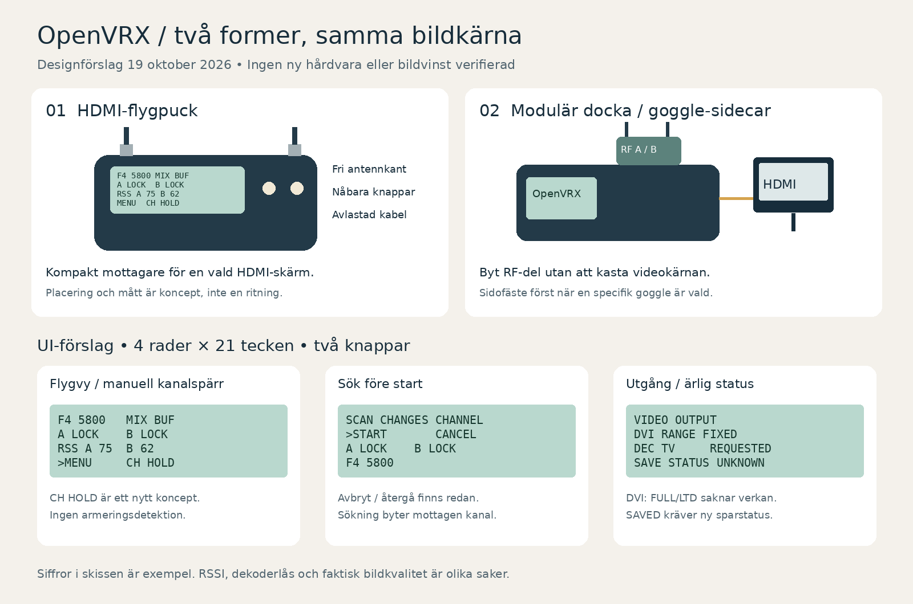

# OpenVRX: nästa produktsteg och mottagarval

Design council, 19 oktober 2026. Användarens prioritering: bättre analog bild och mottagning för flygning samt en öppen mottagare för HDMI, goggles och markstation. Verktyg är inget eget produktspår.

**Rekommendation:** bygg vidare mot en kompakt HDMI-flygpuck, med en utbytbar RF-del. En docka för goggles eller markstation kan använda samma kärna. Behåll RX5808 som första referens, men lås inte nästa produkt till RichWave. ESP32-C5 och Analog Devices ger verkliga andra vägar; bättre flygbild än RX5808 är ännu inte visad för någon av dem i jämförbara prov.

Det finns arbete kvar utan hårdvara. Mest direkt produktnytta ger ett tydligare tvåknappsgränssnitt och en specificerad mottagargräns. Ytterligare helsviter eller RF-simulering utan verkligt mätunderlag är inte nästa produktsteg.

## Vad rådet faktiskt har granskat

Tre separata agentgranskare för produkt/UX, roadmap och RF samt root som samordnare. Granskarna lämnade egna bedömningar och svarade därefter på invändningar om befintliga funktioner, sanningsenlig status, bandbredd, licens och mätbar bildvinst. Fyra rådgivande röster redovisas nedan. Det är ett nytt användarbeställt råd, inte en omkörning av gamla kreditstoppade råd eller ett godkännande av deras produktionsfixar.

Fjärrlästa och hämtade revisioner: nav `5f7a7c54d67fabd47e7c11986c5d5b5bf33f3b00`, Core `8dff8d1b4d5f1987a23c3f332f730119fccbd909`, Puck `84a79d61c4ebb46981329be39fafcd7447c32150`. Pucks faktiska gitlink pekar på denna Core. Historiska primärcheckouter är bevarade. Inga tester, simuleringar, FPGA-byggen, installationer, inköp eller hårdvaruåtgärder har körts. Inga meddelanden har skickats till tillverkare. Automatiken förblir pausad.

Aktuell plan rapporterar 797 gröna tester och ett senare lyckat M6-bygge med HDMI och VINTERP samtidigt. Det är inkommande rapporter, inte ny rootgranskad körning i detta råd. Den tidigare bf05-källans placeringsstopp och tidigare accepterade paket behåller sina exakta revisioner och begränsningar. [Levande plan vid läst revision](https://github.com/LAP87/OpenVRX/blob/5f7a7c54d67fabd47e7c11986c5d5b5bf33f3b00/docs/ARBETSPLAN.md), [Core-status](https://github.com/LAP87/OpenVRX-Core/blob/8dff8d1b4d5f1987a23c3f332f730119fccbd909/README.md).

## Vad är inte klart?

| Återstående fråga | Vad kan göras utan hårdvara? | Vad kräver verklig produkt eller bänk? |
|---|---|---|
| Flyggränssnittet | Prova begripliga knappflöden, kanalspärr, ogiltig RSSI och vad inställningarna faktiskt betyder. | Läsbarhet, knappåtkomst och att OSD inte stör flygningen. |
| Sparstatus och vald/tillämpad inställning | Specificera vilka kvitton UI behöver. Nuvarande `flash_ready` betyder startläsning klar, inte senaste ändring sparad. | Flash, uppstart och verkligt felbeteende; ingen timer får ensam visa `SAVED`. |
| Kapslad rev A | OLED- och RX5808-SPI-anslutningar behöver bli åtkomliga i sandwichen. Det finns en dokumenterad kontaktlucka. | Måttritning/kortpassning, temperatur, kabeldragning och routning. |
| Utbytbar RF-del | Beskriv CVBS, last, matning, styrning, RSSI och status per mottagarprofil; markera saknade data. | Elektriska nivåer, störning, selektivitet och bildprov för varje verklig modul. |
| VINTERP:s indatagräns | Bestäm produktens stödområde och önskat beteende vid felaktig/större inbild. | Inte ett belagt generellt fel för normala 240/288-radersfält. Vid 720 utrader omfattar beviset högst 360 källrader; större källor är en separat fråga. |
| Senaste källans acceptans | En enda avstämning av ändrade källor mot befintliga råkvitton före nästa produktionsändring. Återanvänd giltiga resultat. | Bara identifierade nya bevisluckor motiverar framtida riktade körningar. |

SCAN, avbryt med valfri knapp, återgång till startkanal, RSSI-kalibrering, flashinställningar och HDMI FULL/LTD finns redan. De ska inte återimplementeras som nya idéer. Den levande planens öppna SCAN-likapoängrad är gammal: senare samma plan anger fixen, och aktuell RTL behåller startkanalen vid lika poäng. Puck README säger fortfarande att submodulen pinnar `ff2efce`, trots faktisk gitlink `8dff8d1`; det är gammal prosa, inte fel gitlink. Planens ”inget kvar utan kortet” är därför för kategoriskt. Små dokumenträttelser kan följa nästa relevanta produktändring, utan ett eget dokumentprojekt.

Underlag: [puck_ui.v](https://github.com/LAP87/OpenVRX-Core/blob/8dff8d1b4d5f1987a23c3f332f730119fccbd909/gateware/rtl/puck_ui.v), [M6-toppen](https://github.com/LAP87/OpenVRX-Core/blob/8dff8d1b4d5f1987a23c3f332f730119fccbd909/gateware/top/m6_puck_proto.v), [formalbegränsningar, punkt 7](https://github.com/LAP87/OpenVRX-Core/blob/8dff8d1b4d5f1987a23c3f332f730119fccbd909/gateware/formal/README.md), [rev A-layoutens öppna punkter](https://github.com/LAP87/OpenVRX-Puck/blob/84a79d61c4ebb46981329be39fafcd7447c32150/design/rev_a/LAYOUT.md).

## Produktnischer och fysisk design

**1. Kompakt analog HDMI-flygpuck.** Två mottagarvägar, öppet bildflöde och en enkel panel före start. Antennanslutningar på en fri kant, HDMI/matning med kabelavlastning, skyddade knappar och ett ställ eller clip. Börja med ett bestämt HDMI-skärmset och befintlig strömkälla. Batteriladdning, DVR, digital HDMI-ingång och 1080p/XR behöver inte tillkomma för att avgöra om grundprodukten är bra. HDMI-kontakt betyder inte USB-C-video eller kompatibilitet med alla goggles.

**2. Modulär mottagardocka, senare goggle-sidecar.** Samma videokärna, men RF-delen är åtkomlig och kan ersättas. Börja på bord/stativ; sidofäste vid goggles först efter vald modell, viktbudget och kontakter. Detta kan också ge en mottagare med äldre extern CVBS-modul en öppen skärmutgång. En premiumdiversitymoduls enda redan mixade CVBS-utgång kan däremot inte ersätta två separata videovägar till OpenVRX:s egen mixer.

Det är två former av samma produktplattform, inte två nya huvudkort. Nyttan och efterfrågan är hypoteser; rådet har inte genomfört kundstudie eller konkurrensmätning. RF-skärmning, separation från digitaldelen och ventilation är konstruktionsmål, inte verifierade prestandavinster i bilden.

## UI/UX som förbättrar den befintliga produkten

- **Ren flygvy.** Kanal/frekvens och nödvändig mottagarstatus, kort OSD efter knapptryckning. En föreslagen manuell `CH HOLD` spärrar oavsiktlig kanaländring och SCAN. Den är ny, måste ha tydlig upplåsning och vet ingenting om armering eller faktisk flygning. `LOCK` ska fortsätta betyda dekoderlås.
- **Medveten SCAN före start.** Visa att sökningen byter mottagen kanal. Behåll redan implementerat avbryt/återgång. Hittad låst kanal är inte bevis att rätt pilots VTX hittats; användaren måste se rätt bild.
- **Ärlig status.** Håll RSSI, dekoderlås, mixeranvändning och bildstatistik isär. Relativ RSSI är inget kvalitetsbetyg eller räckviddslöfte. Ogiltig/okalibrerad data visas som okänd. TV/VCR är en dekoderbegäran, inte val av bildskärm.
- **Rätt HDMI-beteende.** FULL/LTD finns i HDMI-bygget. DVI-bygget ignorerar valet och bör visa det otillgängligt. `SAVED`, sparfel och verifierat tillämpad dekoderinställning kräver verkliga statuskanaler; de får inte uppfinnas i mockupen.

Skissen använder fyra rader med högst 21 tecken och två knappar. Värden är exempel. Nuvarande defaultlägen ändras inte genom förslaget.

## Kan RX5808 bli bättre?

Ja, det finns rimliga förbättringsvägar. Vilken som hjälper måste avgöras med samma RF-signal och samma bildkriterium, inte med olika produkters marknadsförda dBm-tal.

| Prioritet | Förbättring att pröva senare | Vad kan gå fel? |
|---|---|---|
| 1 | Antenn/polarisation/placering, förlust före mottagaren, korrekt lastad CVBS. | Riktverkan och kroppsskugga kan göra en starkare antenn sämre i vissa riktningar. |
| 2 | Matning, avkoppling, jord/retur och isolering från HDMI, FPGA, SDRAM och DC/DC. | Nya jord- och skärmvägar kan själva koppla in störningar. Jämför störkällor av/på. |
| 3 | Rätt kanalcentrum och matchning till verklig FM-deviation/video. | Nuvarande M6 programmerar båda mottagarna gemensamt. Individuell AFC/kalibrerad frekvensstyrning är inte en befintlig funktion. |
| 4 | RF-filter och vid behov LNA med nivåbudget/bypass. | Filterförlust försämrar svagsignal; hög förstärkning kan ge kompression, blockerproblem och intermodulation. Mer gain är inte automatiskt bättre bild. |
| 5 | Egen MF/filteranpassning eller nytt RF-kort. | För smalt filter kan skada färg, detaljer och FM-linjäritet. Kräver dokumenterad modul och uppmätt begränsning först. |

Nuvarande tuner skriver syntesregister 1 för båda mottagarna. Källan beskriver också en avvägning: upprepad omskrivning stoppas när någon dekoder låser, eftersom bildstörningen av omskrivning inte är mätt. Gör därför inte automatisk omtrimning under flygning till en kostnadsfri mjukvaruförbättring. [rx5808_tune.v](https://github.com/LAP87/OpenVRX-Core/blob/8dff8d1b4d5f1987a23c3f332f730119fccbd909/gateware/rtl/rx5808_tune.v).

Efter demodulation till CVBS saknas RF-fasen som krävs för koherent kombination. OpenVRX:s radval/blandning kan välja mellan olika bildfel, men är inte RF-MRC och ska inte få en påhittad generell dB-vinst. En annan chipmodell räddar inte automatiskt fel matning, dålig antenn eller egenstörning.

## Alternativ utan RichWave

| Kandidat | Vad är verkligt belagt? | Rekommendation för oss |
|---|---|---|
| **ESP32-C5 / C5VRX** | Espressifs radio används av ett öppet projekt för analog FM till CVBS via en motstånds-DAC. En liten faktisk alternativ arkitektur. | Mest intressanta kompakta forskningsspåret. Ingen jämförbar bättre flygbild eller räckvidd visad. Odokumenterade radiolägen, kanaltäckning, CVBS-last och licens behöver en separat grind. |
| **Analog Devices AD9361 / AD9364** | Mottagning upp till 6 GHz och kanalbandbredd upp till 56 MHz; digital IQ, inte CVBS. AD9361 har två mottagarkanaler, AD9364 en. | Verkliga icke-RichWave-chip, men kräver egen FM-/videokedja och resurs-, effekt- och latensbudget. En ny arkitektur, inte ett byte på RX5808:s plats. |
| **ADL5380 med LO/ADC/DSP** | IQ-demodulator som täcker 400 MHz–6 GHz. | Möjligt byggblock till egen mottagare; nästan hela videomottagaren återstår. Lägre prioritet. |
| **MM238RW / FS58R3MW och andra okända moduler** | Modulnamn och gränssnittsuppgifter identifierar inte chipet under skärmen. | Kan vara jämförelseobjekt, men räknas inte som verifierat fritt från RichWave. |

Primärkällor lästa 2026-10-19: [AD9361](https://www.analog.com/en/products/ad9361.html), [AD9364](https://www.analog.com/en/products/ad9364.html), [ADL5380](https://www.analog.com/en/products/adl5380.html), [Espressifs C5-datablad](https://documentation.espressif.com/esp32-c5_datasheet_en.html). AD9361:s publicerade NF-exempel vid 800 MHz får inte överföras till 5,8 GHz. Ett SDR-korts avstämningsområde garanterar heller inte att dess ingångsnät är bra vid 5,8 GHz.

C5VRX:s granskade revision är `37fb77052d31f61c8a2fc8996bd72fc876a56c01`. Den beskriver 40 MS/s IQ och 6-bitars CVBS-DAC, fler styrfunktioner än projektets äldre forskningsnoter samt flera uttryckligen ej kortprovade filter-/profilidéer. IQLaneFusion anges inte vara en demonstrerad bild- eller räckviddsförbättring. [Fast README](https://github.com/Twotoz/C5VRX/blob/37fb77052d31f61c8a2fc8996bd72fc876a56c01/README.md), [projektets öppna ärende 201](https://github.com/Twotoz/C5VRX/issues/201).

C5VRX har GPL-3.0-only. OpenVRX:s nuvarande kodregel tillåter inte GPL-import. Ingen kod har kopierats. En separat receiverfirmware som levererar CVBS kan diskuteras som systemalternativ, med ett uttryckligt beslut om licens och leveransgräns; detta råd avgör inte alla sådana frågor. [Licens vid samma revision](https://github.com/Twotoz/C5VRX/blob/37fb77052d31f61c8a2fc8996bd72fc876a56c01/LICENSE).

RichWaves offentliga tabell listar RTC6715 för 5,8 GHz. Det bevisar inte att alla bättre mottagare innehåller den eller att inget annat chip existerar. Chip i premiumprodukter är fortfarande delvis oidentifierade, och en produktlistning utan EOL-märke är ingen verifierad Active-status. [RichWaves lista](https://www.richwave.com.tw/en/page_prd_new.aspx?Id=8).

## Rådets beslut

| Förslag | Roadmap | Produkt/UX | RF | Root | Utfall |
|---|---|---|---|---|---|
| P1 Verktyg som egen produkt | NEJ | NEJ | NEJ | NEJ | Avförs enligt användaren. |
| P2 Smal flyg-UI/interaktionsprototyp | JA | JA | JA | JA | Rekommenderas först; befintliga funktioner återanvänds. |
| P3 Mottagargräns och utbytbar RF-del | JA | JA | JA | JA | Specifikation först; inga nya pins eller nivåer på gissning. |
| P4 Optimera och jämföra RX5808 före byte | JA | JA | JA | JA | Senare hårdvarujämförelse. Fyll bara verkliga luckor i befintliga mätblad. |
| P5 Full icke-RichWave SDR-fork | VÄNTA | VÄNTA | VÄNTA | VÄNTA | Kandidaterna är verkliga; full utvecklingsgren väntar på konkret ouppfyllt krav. |
| P6 Nytt RF-/FPGA-kort direkt | NEJ | NEJ | NEJ | NEJ | För tidigt före baslinje och gränssnitt. |

Fyra verkligt avgivna rådgivande röster; JA innebär enighet om den angivna avgränsningen, inte produktions-, krets- eller hårdvaruacceptans. Gamla rådsstopp, defaultbeslut och ägarskap ändras inte.

## Nästa avgränsade arbete

**Först: flyg-UI som går att bedöma.** Högst två timmar, privat prototyp/specifikation med nuvarande 4×21-tecken och OK/NEXT. Visa kanalval, manuell kanalspärr, SCAN/avbryt, ogiltig kalibrering, DVI utan verksamt FULL/LTD och okänd sparstatus. Ägda framtida filer: `private/notes/puck_flight_ui_prototype/`. Klart när tre konkreta användaruppgifter kan genomföras och varje status kan härledas till befintlig signal eller tydligt nytt kontrakt. Stoppa om det bara ritar om redan begripligt beteende. Ingen RTL eller ny testsvit ingår.

**Därefter: mottagargränsen.** Högst 90 minuter för endast luckorna i befintliga underlag. Ägda framtida filer: `private/notes/receiver_interface/`. Mappa RX5808 och en alternativ mottagare mot CVBS-last/nivå, matning, gemensam/separat styrning, RSSI-giltighet och tune/status. CVBS före dekodern och BT.656 efter den är två olika gränser. Stoppa vid okända nivåer; ingen universalkontakt eller ny BOM uppfinns.

**Bildvinst avgörs sedan på bänken.** Återanvänd befintliga mätblad och fyll endast saknade krav: samma VTX/deviation, rörlig bild, RF-nivå, blockerare, multipath, egenstörning och total latens. Först då kan RX5808-optimering jämföras med C5 eller ett premiumreferenssystem. Ingen ny simuleringsmodell ersätter det provet.

Större/felaktiga VINTERP-inbilder och C5-licens/arkitektur får egna uppgifter endast om de blir produktkrav. Inget av nästa arbete har startats av rådet. Den återkommande automatiken är fortsatt pausad; detta paket avslutas med rapport, röster och sparat checkpointläge.
