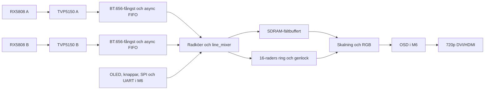

# OpenVRX — övertagandegranskning 2026-10-05

Granskningen avslutades efter 22:10 svensk tid den 5 oktober 2026. Underlag: arbetsfiler, Git-historik, de 20 öppna GitHub-ärendena, byggloggar, den fulla testkörning Claude redan hade startat och egna motexempel. Produktkod, schemascript, submodul och sparade produktutdata har inte ändrats.

**Bedömning:** här finns en omfattande implementerad FPGA-prototyp och användbara verifieringsverktyg. Dagens M3/M4/M6-bitströmmar finns och klarar slutlig intern timing efter routning. Men den centrala radmixern har reproducerbara funktionsfel, schema och Core-version är inte färdigsynkroniserade, och ingen hårdvarukörning är dokumenterad. Nästa utvecklingssteg bör vara att få bildkedjan korrekt och överlämningen reproducerbar.

Denna rapport beskriver övertagandeläget före Codex ändringar. Orden
"dagens" och "nu" nedan avser den granskningen. Slutacceptansen efter
ändringarna finns i [RESULTAT.md](RESULTAT.md), och exakta Git-jämförelser
finns i [README.md](README.md).

## 1. Vad projektet är nu

En analog 5,8 GHz-markmottagare: två mottagare på samma kanal, två TVP5150AM1-dekodrar, en FPGA som väljer eller blandar bilden radvis, sedan 720p till HDMI/DVI. Puck-idén lägger till batteri, OLED, knappar, antennkontakter och senare fler bildgränssnitt.

| Del | Verkligt innehåll | Läge |
|---|---|---|
| `OpenVRX` | Nav, forskningsanteckningar, uppstartsunderlag och granskningsinbjudan | Ren `main`, HEAD `4fd0f11` |
| `OpenVRX-Core` | Verilog, Python-modeller, cocotb/Icarus-testbänkar, byggskript och mätverktyg | `bringup-pins`, HEAD `dec88d6`; 17 modifierade och 6 nya filer |
| `OpenVRX-Puck` | Produktkoncept och dekoderkortets schema som SKiDL-kod | `resetb-j6-18`, HEAD `bdee8e4`; 2 modifierade filer |
| `OpenVRX-Puck/core` | Pucks pinnade Core-submodul | Ren, detached på `dec88d6`; innehåller inte dagens ändringar |
| `private/` | Inköpsunderlag, äldre arbetsanteckningar, råkällor, granskningsmaterial och LT8618SX-spåret | Separat från repona |

Alla tre GitHub-repon var **privata** vid kontrollen, även om README och licens beskriver ett öppet projekt. Det är den faktiska synligheten, inte en bedömning av licensen.

Arkitekturen i den aktuella koden:



`mixer/` är en äldre offline-prototyp i Python. Den justerar inspelningarnas tids- och bildförskjutning. Den radvisa FPGA-mixern gör inte samma bildjustering; god verklig blandning mellan två dekodrar återstår därför att mäta.

## 2. Var Claude slutade

Dagens arbetsfiler åtgärdar delar av granskningsärendena Core #6, #8, #9, #12 och Puck #1:

- RESETB är flyttad från Tang-stift 25/J6-10, i HDMI-banken och på CEC-ledningen, till LED3-stift 18/J6-18 i M3/M4/M6 och schemascriptet.
- M4 har fått RX5808-SPI. `rx_tune.v` skriver F4 en halv sekund efter start och åter varannan sekund så länge ingen dekoder rapporterar lås. SPI DATA ligger hög i vila på LED-stiftet.
- M6 har fått periodisk omskrivning av kanalen när båda dekodrarna saknar lås. M6 gör fortfarande sin första skrivning direkt efter återställning; den fördröjda första skrivningen gäller M3/M4.
- Kommentar, slavmodell och M3:s friska NTSC-exempel använder rätt betydelse för statusbit 5; exemplet är nu `000E`, inte `402E`.
- BRINGUP anger att nuvarande koppling förutsätter Tang-rev 3923, beskriver MODE-knapparna och fler delade stift. Pull-testet lämnar YOUT7-adressstrappen utan ändrad pull.
- M4/M6 har egna SDC-klockkrav. Byggskriptet visar den sista frekvenstabellen efter routning.
- En ny stiftkontroll förbjuder enkeländade utgångar i TMDS-bankerna och innehåller den gamla resetplaceringen som negativ kontroll.

Detta arbete är ocommittat. Inga Core-PR:er fanns vid kontrollen. Alla 16 Core-ärenden och 4 Puck-ärenden var fortfarande öppna. Att ett ärende är öppet betyder här inte att ingen del av det har implementerats.

## 3. Vad som faktiskt är verifierat

Den redan pågående fulla körningen i dagens Core-arbetskatalog slutfördes under granskningen:

```text
55 passed in 574.41s (0:09:34)
```

Jag kontrollerade processens arbetskatalog och kommando, läste slutloggen och gjorde egen testinsamling: **55 tester**. Jag startade inte en andra identisk full körning. README:s 52 är föråldrat för denna arbetskatalog. De tre nytillkomna testerna är RX5808-omsändningen samt stiftkontrollens positiva och negativa fall.

Testerna täcker bland annat BT.656, mixerns normala syntetiska fall, M2 med SDRAM-modell, låglatensläget i en skalad testbänk, TVP-registertrafik, SPI, OLED, OSD, statistik, UART-format och formella kontroller. De ger inte en sammanhängande systemverifiering av hela M4/M6-toppen under realistiska fel och signalåterkomst. PLL-, I/O-, SDRAM- och skärmmodellerna har praktiska begränsningar.

Befintliga byggloggar från 5 oktober, sista resultatet efter routning:

| Top | LUT4 av 20 736 | BSRAM av 46 | SDRAM: fmax/krav MHz | Pixel: fmax/krav MHz |
|---|---:|---:|---:|---:|
| M3 | 2 356 | 0 | — | — |
| M4 | 7 072 | 24 | 85,46 / 64,80 | 110,44 / 74,25 |
| M6 | 10 324 | 24 | 87,90 / 64,80 | 106,81 / 74,25 |

Alla listade slutliga klockkrav passerar. M6-loggens tidigare uppskattning efter placering visar ett SDRAM-FAIL, men slutresultatet efter routning passerar; de tabellerna får inte blandas. Ingen ny syntes eller routning kördes i denna granskning. Intern statisk timing bevisar inte kablarnas eller SDRAM-DQ:s marginaler, HDMI-låsning eller bildkvalitet.

De installerade verktygen stämmer med de pinnade versionerna: Icarus 12.0, cocotb 2.1.0, pytest 9.1.1, Apicula 0.32 och SKiDL 2.3.0. Både Core och Puck använder symlänkar till den gemensamma `.toolchain/`.

Formella bevis finns för små konfigurationer av async FIFO och genlock-räknarnas gränser, med negativa kontroller. De täcker inte backendens bufferthandskakningar, god bildparning eller en lägsta giltig HDMI-bildlängd.

## 4. Felen som styr nästa steg

### Radmixern: kanalhälsa och ordning är inte säkrade

Detta är redan beskrivet i [Core #1](https://github.com/LAP87/OpenVRX-Core/issues/1), [#2](https://github.com/LAP87/OpenVRX-Core/issues/2), [#3](https://github.com/LAP87/OpenVRX-Core/issues/3) och [#5](https://github.com/LAP87/OpenVRX-Core/issues/5), och finns kvar i dagens RTL.

`line_mixer.v` kontrollerar `bada/badb` i grenen för två rader med samma nyckel. Grenarna för ensamma eller förskjutna rader väljer efter aktuell kanal och radavstånd. Där kan en olåst eller uttryckligen bortvald kanal visas. Radnummer kan dessutom gå bakåt. `fb_sdram.v` och låglatensskrivaren tolkar det som ett nytt fält.

Eget motexempel mot oförändrad produktkod: 24 aktiva + 20 blankrader per fält, tre fält, B fem radperioder senare än A och `EXT_B=1` under hela körningen:

| Invariant/resultat | Observerat |
|---|---:|
| Rader från uttryckligen olåst B som visas | **65** |
| Visade rader totalt | 136 |
| Radnummer som går bakåt inom samma F-värde | **56** |
| Fältstarter enligt backendens regel tillämpad på utströmmen | **59**, mot 3 källfält |
| Overflow-flagga | 0 |

Detta är en RTL-körning av mixer2 och en kontroll av dess utström. SDRAM/HDMI kördes inte i just detta motexempel. Poängen är de brutna egenskaperna, inte att de skalade fälten skulle motsvara en komplett NTSC-kamera.

Egen positiv kontroll med projektets befintliga normala stimulus ger exakt **49 beslut och 17 640 ord**, lika referensmodellen. Samma implementation kan alltså passera den befintliga kontrollen och bryta dessa egenskaper.

`TIMEOUT=65536` motsvarar cirka 1,01 ms vid 64,8 MHz. En vertikal lucka på 20 NTSC-radperioder är cirka 1,27 ms. Friska kanaler hinner räknas som döda. Jag körde också ett riktat fall med 20 blankrader och brusnivåer inom hysteresområdet: **9 av 49 beslut skilde sig från referensmodellen**, utan overflow. Modellen antar att båda kanalerna alltid är levande. Den vanliga testbänken har bara två blankrader och döljer denna lucka.

Köhanteringen har ytterligare en öppen brist: en rad som delvis tas emot medan kön är full kan få gammal data i början när en plats frigörs. Overflow är inte synligt i M6:s logg eller OSD. Det är kodgranskat och beskrivet i #5; ingen ny överflödeskörning gjordes här.

### Fältnumreringen förutsätter växlande F

[Core #4](https://github.com/LAP87/OpenVRX-Core/issues/4): `bt656_rx.v` nollställer radnumret när F ändras. Vid 240p/288p-liknande källor kan F ligga still, trots återkommande vertikal blankning. Då fortsätter numreringen genom nästa bild och dekodrar som startade vid olika tidpunkter paras inte rätt.

Koden är fortfarande oförändrad. En egen körning av referensmodellen med konstant F över tre skalade bilder gav radnummer upp till 70 och **ingen omstart**. Detta är modellkontroll plus RTL-läsning; den tidigare RTL-reproduktionen finns i ärendet. M3-dokumentationen beskriver nu symptomet `fld 000`, men funktionen är inte rättad.

### LOW kan ge alltför korta bilder

[Core #10](https://github.com/LAP87/OpenVRX-Core/issues/10): en genlock-trigger under aktiv bild sätter `jump` och avslutar bilden tidigt. Mixerns falska fältstarter kan skapa just sådana triggers.

Egen liten RTL-testbänk gav tre normala bildperioder på 168 cykler, sedan **56 cykler** efter en trigger under aktiv bild. Den naturliga låsta bilden i samma konfiguration är minst 154 cykler. De formella bevisen tillåter detta eftersom de bara begränsar maximal bildlängd. Verkliga skärmars reaktion är inte testad.

### SDRAM och trippelbuffert behöver egen acceptans

[Core #7](https://github.com/LAP87/OpenVRX-Core/issues/7) gäller SDRAM-modellens tidsantaganden, burstläsning och klockfas. Den lokalt sparade föregångarens PLL använder `PSDA_SEL=1010` (225°); OpenVRX använder `1000` (180°). Kommentarens påstående om samma hårdvaruprovade konfiguration håller därför inte fullt ut. Dagens SDC tillför interna klockkrav men löser inte denna I/O- och samplingsfråga. Fas, DQ-fel per bit och läsposition behöver prövas med en separat minnestesttop före M2.

[Core #11](https://github.com/LAP87/OpenVRX-Core/issues/11) beskriver en tidigare simulerad klockdomänkapplöpning som kan låta skrivaren använda visad buffert om källan är lite snabbare än utgången. Jag har läst den kvarvarande trippelbuffertlogiken men inte gjort om den tidigare fasavsökningen. Den föreslagna fjärde bufferten är inte implementerad.

### TVP och I2C återhämtar sig inte tillräckligt

[Core #9](https://github.com/LAP87/OpenVRX-Core/issues/9) är bara delvis åtgärdat. Felvänd beskrivning av statusbit 5 är rättad. Men TVP-init görs fortfarande bara en gång, `dev_err` är fortfarande sticky, och ett TVP-spänningsfall kan lämna bildutgångarna avstängda tills FPGA-logiken startas om. M6:s två knappar är menyknappar.

En extra egen RTL-kontroll visar att en normal transaktion mot en saknad slav avslutas med NACK, medan permanent låg SCL lämnar mastern `busy=1` efter 2 000 cykler, utan avslut. Koden saknar timeout och bussåterhämtning. Det är en extra iakttagelse från denna granskning och inte ett nytt publicerat ärende.

Kanalomsändningen i RX5808-styrningen gäller bara när ingen dekoder är låst. En andra mottagare som startar sent eller tappar sin matning får därför ingen automatisk omskrivning medan den första håller lås. Det är ett avsiktligt försiktigt val i kommentarerna, med okänd effekt av omskrivning på en frisk bild. Separat mottagaråterhämtning återstår att utforma eller begränsa uttryckligen.

## 5. Schemaöverlämningen är ännu inte sammanhängande

Dagens schemascript lägger reset på J6-18. Den sparade och Git-spårade netlistan, BOM:en och kopplingsrapporten är från 4 oktober. Rapporten lägger fortfarande reset på **J6-10** och innehåller den borttagna 10 kΩ-resistorn.

Dessutom kontrollerar scriptet mot `OpenVRX-Puck/core`, alltså gammal Core. Där är LED3/stift 18 fortfarande `~cur`, medan den riktiga resetutgången ligger på stift 25. Jag byggde dagens schemascript i en isolerad utmatningsmapp och fick:

```text
110 parts
ERC: No errors or warnings
Design check: inga problem
Reset på J6-18
Kontrollerad Core: dec88d6
Core: assign led = ~{locked_ok, have_video, cur, b_lines, a_lines, sec[24]};
```

Kontrollen jämför stiftnummer för namnet `led[3]` och missar att signalens funktion är fel i den pinnade versionen. Detta är både en ofärdig submoduluppdatering och en för svag kontraktkontroll. [Puck #1](https://github.com/LAP87/OpenVRX-Puck/issues/1) säger redan att script, utdata och Core-bump ska ändras tillsammans.

Schemascriptets ERC passerar nu självständigt, men det finns fortfarande ingen KiCad-schemaredigering, ingen layout, inga DRC-resultat, ingen provad mekanik eller signalintegritet. Netlistegenereringen gav också 226 varningar om automatiska taggar; de är separata från ERC-resultatet och påverkar reproducerbarheten i genererade identifierare.

Övriga komponent- och layoutfrågor i [Puck #2](https://github.com/LAP87/OpenVRX-Puck/issues/2) och [#3](https://github.com/LAP87/OpenVRX-Puck/issues/3) är kvar: PTC:ns hold/trip-dimensionering för angiven last, temperaturklass, PLL-matningens avkoppling, ESD-kedja och fler jordanslutningar. Livscykelunderlaget är daterat 4 oktober; jag har inte gjort en ny tillverkarkontroll av hela BOM:en eller valt nya delar.

Bitströmmarna i `private/bitstreams/` är också äldre kopior. SHA-256 för M4 och M6 skiljer sig från dagens filer i Core `gateware/build/`. De behöver en tydlig bygg- och kopplingsrevision vid användning; blandade gamla filer kan återinföra de gamla stiftproblemen.

## 6. Produktluckan: XR och 1080p

Den fungerande utvecklingsvägen i Core är **720p-utmatning**. Projektets XR-underlag säger att flera tänkta glasögon kräver 1080p och att 50 Hz/varierande timing behöver kontrolleras. Det är tidigare research, inte ny sink-verifiering i denna granskning.

M5C:s LT8618SX-init, topp och testtillägg ligger i `private/lt8618-m5c/`; hela vägen kan inte byggas från enbart Core-repot. Ursprunget till initsekvensen är inte klarlagt, och den gamla M5C-stiftplanen använder konfigurations-/HDMI-DDC-stift. 1080p/XR är alltså ett separat öppet utvecklingssteg.

GW5A-25, ESP32-C5/C5VRX, direkt USB-C/DP, HDMI-in för digitala mottagare, batteri/PD och slutligt skal är koncept eller kandidater. De är inte levererade funktioner i dagens prototyp. EMI-planen behöver också inkludera mottagarens mellanfrekvens, enligt [Puck #4](https://github.com/LAP87/OpenVRX-Puck/issues/4), och prövas på en flyttbar bänkrigg före skaldesign.

Glas-till-glaslatens och verklig nytta av mixningen är fortfarande omätta. Siffran 0,1–0,8 ms avser den föreslagna interna FPGA-vägen och får inte användas som hela systemets latens. Dekoder, kamera, omvandlare och skärm kommer ovanpå.

Latensverktygets tidigare fel med 500 ms och namnlösa skärmar är rättade i nuvarande kod och omfattas av testsviten. En liten återstående brist finns i `pair_delays`: samma skärmkant kan användas två gånger. Ett direkt funktionsanrop med LED-kanter 10/12, skärmkant 16, lagg 6 och tolerans 2 gav både 24 och 16 ms från samma skärmblinkning. Detta är ett hjälpfunktionsmotexempel, inte en uppmätt felanalys av en riktig inspelning. En-till-en-parning bör säkras före mätacceptans.

## 7. Rekommenderad fortsättning

Ordningen nedan är en prioritering, inte genomförd utveckling.

1. **Slutför dagens överlämning.** En accepterad Core-version, matchande Puck-submodul, regenererade schemautdata och dokumenterad bitström/koppling. Stiftkontrollen måste upptäcka fel signalbetydelse, inte bara rätt pin. Uppdatera testantal och kvarvarande gamla sökvägar. Berör främst Core #6/#8/#12/#14 och Puck #1; #9 är bara delvis gjort.
2. **Gör mottagning och mixer korrekt.** Gemensamt paket för Core #1–#5: V-baserad omstart för stillastående F, korrekt kanalhälsa över vertikal blankning, väntfönster för parning, monotona rader, verklig verkan av tvingat A/B, helradsförlust vid kööverflöde och synlig felstatistik. Modellen ska omfatta kanalernas liv/återkomst. Acceptans: frisk kanal ersätts aldrig av en uttryckligen dålig, och radnummer går inte bakåt inom ett verkligt fält.
3. **Säkra backend och LOW.** Core #7/#10/#11: minnestesttop, timingmedveten SDRAM-modell med negativa kontroller, buffertägarskap över klockdomäner och övre/nedre bildlängdsgränser för genlock. Fältparitet och gemensamt radantal från #15 bör ingå när visningen ses över.
4. **Återhämtning och diagnostik.** Återinit av TVP, status som blir frisk igen efter NACK, hantering av bussfel, mottagarnas olika uppstartstider samt UART-logg som klarar trasiga rader. Windows-stödet i #13 är en senare portabilitetsfråga på denna Linux-maskin.
5. **Kontrollerad bänkstart.** Bekräfta Tang-revision och modulernas I/O-matning. M0 testar HDMI; M3 testar koppling/dekoderstyrning; separat SDRAM-test före M2/BUF; sedan korrekt M4 och M6. Använd dagens egna dekodermoduler enligt inköpsplanen, så Moneagle-avtappning inte krävs. Inga inköp eller leveranser antas vara bekräftade av en inköpslista.
6. **Välj och prova 1080p/XR-vägen.** Gör detta innan Pucken får slutlig mekanik. Mät hela kedjan, brus/mixnytta, signalbortfall, EMI och skärmens återlåsning. Batteri, PD och digitala tillägg kan sedan byggas på en verifierad bas.

Core #16, att i BUF visa fältet medan det skrivs, är en optimeringsidé och bör vänta tills buffertägarskap och korrekt bildordning är lösta.

## 8. Reproducerbart underlag

Egna scripts, loggar, resultat, Git-snapshot, klockresultat och lästa ärenden finns i [det sparade motexempelunderlaget](evidence/audit_before_changes/) och [scripts](evidence/historical_scripts/). SHA-256-kontrollen gav **inga ändringar i produktens ursprungliga arbetsfiler under granskningen**. Det enda nya beständiga materialet är denna rapport och dess privata granskningsunderlag.
